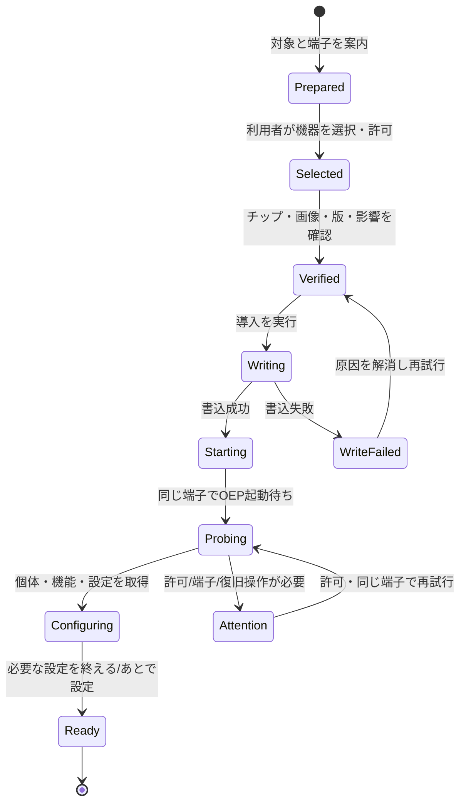

# OEP Web — 接続・書き込み引継ぎ仕様

状態: [画面要件](page.ja.md)の補足仕様案。現行実装の動作保証ではない。
対象要件: R03/R04/R05/R09。対象ユースケース: U02/U03/U13。

## 1. 利用者に提供する契約

**機器を一度選んだら、書き込み・再起動・OEP接続・初期設定を一つの作業として続ける。**

- 「同じ接続設定」は、同じ機器・端子・ブラウザの許可と利用目的を保持すること。ROMとOEPで同じbaudや通信セッションを使い続けるという意味ではない。
- 内部でreader/writerの解放、close/open、再列挙待ち、baud変更が必要でも、通常経路で利用者に切断・再接続ボタンを押させない。
- 書込後に「USB / Serial / HIDのどれでつなぐか」「どの種類のプローブか」を選ばせない。
- 標準配布firmwareは、導入に利用できるシリアル経路でOEP接続もできる構成を前提とする。CDC系のUSBシリアルと外付けUART変換を画面で分類・選択させない。
- 速度の速い端子への変更を、初期設定の条件にしない。今の端子で設定できればそのまま続ける。
- ブラウザ許可や機器識別の不足により利用者の操作が必要な場合は、理由と対象を限定し、同じ導入画面内で一度の操作にする。
- 同じ型番やVID:PIDだけで、別の接続済み機器を同一個体と見なさない。

## 2. 接続の入口

### 2.1 書き込みから続く場合

書き込みが使ったdevice/portと導入文脈を直接引き継ぐ。一般的な機器選択パネルを開き直さない。
「OEPとして起動しています → 初期設定を読み込んでいます」を表示する。
成功するとI02の設定カードを有効にし、失敗すると同じ場所に復旧操作を表示する。

### 2.2 導入済みの機器を使う場合

C01は呼出元に重なるパネルまたは同じ画面内の領域とし、独立した設定ウィザードにはしない。

| 文脈 | 主操作 | 補助操作 |
| --- | --- | --- |
| このタブで接続した個体がある | 保持した端子で「再接続」 | 別の機器を使う |
| 過去のOEP個体に対応する許可済み機器を特定できる | 名前・個体ID・前回の用途を載せたカードから接続 | 新しい機器を選ぶ |
| 履歴がなく、案内元から経路が分かる | その経路のブラウザchooserを開く | 見つからない場合の案内 |
| 履歴も経路の文脈もない | 共通の対応機種が広いシリアル選択を主入口にする | 「一覧にない」からOEP USB端子/HIDの説明付き選択へ |

最後の行は製品上の初期値であり、WebUSB/Serial/HIDを一つのchooserに統合できるという要求ではない。
初期値が合わなかったときに同じchooserを繰り返させず、端子の見分け方と次の一手を示す。
USB専用のプローブ等はボード資料の「導入済みを使う」から対応経路へ直接入れる。
接続中にboard一覧を出さず、接続後にOEPからmodel、unit_id、機能を取得する。

許可済み一覧を表示するだけでは、識別できないシリアルポートを順に開いて調べない。
UART bridgeのVID:PIDはOEPの識別ではなく、同じ変換チップを使った無関係の機器もある。
「最近使った」の記録だけで、現在の別機器を自動操作しない。

## 3. 接続引継ぎとfirmware側の前提

### 3.1 シリアルは同じ操作フローで扱う

**書き込めるシリアル経路は、書込後のOEP接続にも使える**ことを標準配布firmwareとの契約にする。
P4ではCDC系のUSBシリアルが主な利用を想定されるが、外付けUART経由も同じ画面・操作にする。
利用頻度の違いを、利用者への接続方式の質問や端子変更の要求に変えない。

ブラウザ側は、利用者が選んだSerialPortを保持して書込処理からOEP接続処理へ渡す。
取得できるUSB識別情報等は補助情報であり、内部の経路や基板上の結線を必ず判別できる前提にしない。
**CDCか外付けUARTかを判別できなくても、同じポートでの継続を行えること**を要件とする。
書込後に型番・変換チップ・方式の分類結果から別のポートを探し直さない。

この共通化は、実行中firmwareのUSB CDC端子ならすべてROM書込にも使えるという意味ではない。
導入前にはそのボードで書込に使える端子を案内するが、書込に成功したポートから設定へ進む際に端子の種類を尋ねない。

### 3.2 引継ぎの処理

下表は実装・検証の区分であり、利用者に選ばせる接続方式の一覧ではない。
リリース可能とするには[受入条件](page-acceptance.ja.md)の実機検証を満たす。

| 機器・導入方法 | 書込後の接続 | 自動で行うこと | 利用者の操作が必要な条件 |
| --- | --- | --- | --- |
| classic ESP32 / シリアル | 同じSerialPortでOEP | ROM処理を終了、通常起動、OEPの初期baudで同じポートを開く | 手動BOOT/RESETが必要、ポート喪失/権限取消、別アプリが使用 |
| ESP32-P4/P4X / 書込に使ったシリアルポート | USB-Serial/JTAG・外付けUARTとも同じポートでOEP | 再起動を待ち、保持したポートを開く。再列挙があれば同一性と許可を確認して続行 | 再列挙で許可が必要、同一端点を特定できない、ポート喪失/占有 |
| RP2040/RP2350 / BOOTSEL | 同じケーブルの実行中OEP USB端点 | 再列挙待ち、同一と確認できる許可済みOEP機器へ接続 | 初回の実行中USB機器への許可、boot時と実行時のID対応が不明 |
| P4/P4X / 既存OEP HS端子のDFU更新 | 同じ個体のHS OEP端点 | 既知unit_idと照合し、再起動後に再接続 | 許可取消、ポート喪失、同一性を確認できない |
| S3/C3/C6 / 持込画像 | 原則として元のシリアルポートでOEP | 同じポートでOEP確認を試みる。別経路を使う画像の明示的な情報がある場合のみ案内に反映 | 画像が元の経路でOEPを提供しない場合は持込画像の構成差として説明 |

P4のHS端子は帯域を必要とする用途への任意の選択肢とし、導入直後の設定のために切り替えさせない。
物理基板上の端子名・配置はチップ名だけでは決まらない。ボード例の写真/図やメーカー資料は、最初にケーブルをつなぐための補助とする。

### 3.3 firmware側の対応状況

2026-11-06の利用者からの方針により、P4のUART bridgeは有効化する方向で別途修正中。
画面仕様はその構成を前提とし、以前の既定値に合わせた「外付けUARTなら別端子へ変更」という分岐を持たない。
配布版への反映と実機での継続は、公開前の確認事項として扱う。

調査履歴: `oep-probe-arduino 3fa25d7`と`v0.0.47`の
[Esp32P4.h](https://github.com/Open-Embedded-Probe/oep-probe-arduino/blob/v0.0.47/examples/Firmware/OepProbe/Esp32P4.h)には、
UART bridgeの実装があり、既定の`oepWithBridge()`は空だった。この過去の構成差は、OEPやWeb Serialが外付けUARTに対応しないという制約ではない。
この文書変更ではfirmwareを編集せず、有効化完了・配布済み・実機検証済みとは扱わない。

## 4. 導入作業の状態遷移

Starting/Probing/Attention/Configuringは同じ導入作業内の表示状態である。
URLが変わっても、機器・書込成功・入力・進行・復帰先を失わない。

| 状態 | 利用者に示す文言の例 | 主操作 |
| --- | --- | --- |
| Selected | 「選択した機器を確認しています」 | キャンセル。選択キャンセルは失敗扱いにしない |
| Verified | 「ESP32…にOEP …を導入します」 | 導入を実行 / 対象を変更 |
| Writing | 「書き込み中 …%」 | 安全に中断できない工程では次工程への移動を抑止 |
| Starting/Probing | 「書き込みは完了しました。同じ機器で設定の準備をしています」 | 待機。長引いたら再試行/端子確認 |
| Attention | 「書込は完了。起動後の機器をブラウザで許可してください」等、原因別 | 対象を絞った許可/再試行 |
| Configuring | 「OEPの導入が完了しました。次に何をしますか」 | 目的別設定 / すぐ試す / あとで設定 |
| Ready | 「このプローブを使えます」 | 作業ホームまたは指定用途へ |

自動再試行は上限を設け、無限の待機にしない。初期設計では最大30秒を目安に待機中の状態を更新し、その後は原因別の操作へ切り替える。
実機測定で待機時間は調整する。時間切れをfirmware書込失敗に読み替えない。

## 5. 引き継ぐ情報と同一性

導入処理から接続処理へ明示的な引継ぎ情報を渡す。

| 情報 | 用途・保持期間 |
| --- | --- |
| 利用目的、呼出元、初期設定の進み具合 | 同じ作業へ戻る。同じタブ内で保持 |
| 選択したSerialPort/USBDevice等 | 元の機器へのアクセス。JavaScriptのhandleをJSON化して永続保存しない |
| 元の経路、書込後に期待する経路 | シリアルでは元のSerialPortをそのまま使う。CDC/UARTの分類は必須情報にしない。画像の明示情報と実機確認は区別 |
| チップID/revision、導入firmware版/画像の識別情報 | 不一致拒否と結果確認。別型番への画像適用を防ぐ |
| 導入前unit_id、取得できたROM固有情報、対応の根拠 | 同一個体の確認。ROM情報からOEP IDへの変換は実装で保証された場合だけ使う |
| 書込結果、OEP確認結果、設定読込結果 | 部分成功を維持し、成功工程を繰り返さない |
| 入力中の設定と保存状態 | 接続の復旧後も保持。ただし別個体へ自動適用しない |

優先順は、保持した端点 → 検証可能な同一個体の許可済み端点 → 利用者が対象を明示して許可した端点。
OEP確認後はunit_id、model、利用可能な機能を検証する。
同一性を判断できない候補が複数あれば、自動で最初の一つを開かない。同型の一台しか見えなくても、それだけで同一性の証明にしない。

タブの再読込後にはhandleも全過程の証拠も残るとは限らない。履歴に「導入を実行した」「起動確認まで完了」等の区別を保持できるが、再接続後の実機状態を正とする。
再読込を理由に自動でflashを再実行しない。

## 6. セッションと通信処理の契約

- ROM書込とOEPは別プロトコル。書込ライブラリが保持するreader/writerを解放してからOEPを開き、同じポートを二重に開かない。
- 書込用baudをOEPへ流用しない。通常のOEPシリアル開始は仕様の初期速度に従う。高速化は別の合意に基づく。
- 接続しただけで通常動作中のプローブをリセットしない。ROMへの移行・書込後のresetは、導入/更新の明示操作に含める。
- 書込後には古いセッションや一時資源を復元したと見なさず、新しいbootの宣言と状態を取得する。
- 機能の読取と設定フォーム表示は、ターゲットへの接続・探索・出力を発生させない。
- 初期設定を読めた後、保存や開始の操作時に必要な変更権を取得する。他の所有者を強制解除しない。
- 接続後のfirmware版が期待と違えば「書込済み」と「期待版の起動を確認できた」を分ける。持込画像では期待版が不明な場合も表示する。
- 新規のmerged画像書込と既存アプリ更新では保存領域への影響が異なる。画像の範囲・形式から保持を保証できない場合、保持すると断言しない。

## 7. 失敗時の画面と戻り先

| 問題 | 保持する結果 | 表示する次の一手 | 禁止する挙動 |
| --- | --- | --- | --- |
| 機器選択をキャンセル | 選択前の入力と用途 | 同じ機器選択を再開 | エラーで入口へ戻す |
| チップ/画像不一致 | 検出情報、未書込の状態 | 適合画像または対象を確認 | 型番を無視して続行 |
| 書込中断・検証失敗 | 完了工程と失敗位置 | ROM待機へ戻す案内→再試行 | 初期設定可能と表示 |
| 書込成功、OEP応答なし | 書込成功・期待する端子 | 同じ端子で再試行、BOOT解除/RESET、対応端子を確認 | 再書込を第一選択にする |
| 再列挙で許可が必要 | 書込成功・個体候補・入力 | 「起動したOEPを許可」 | 一般的な方式選択へ戻す |
| 別の機器が選ばれた | 元の対象と作業 | 不一致を説明し、対象を選び直す | 別個体へ設定を自動適用 |
| 他アプリがポート/変更権を使用 | 設定入力 | 使用中のアプリ/タブを終了して再試行 | forceを自動実行 |
| 設定読込だけ失敗 | OEP接続成功、部分的な読込結果 | 設定の再読込/診断 | 導入からやり直す |
| 作業中に抜線・再起動 | 入力、最後の結果、実行状態の不確実性 | 同じ機器への再接続、状態を読み直す | 出力・転送・書換えを自動再送 |
| 非対応ブラウザ/許可ポリシー | 閲覧内容・用途・選んだボード | 必要なAPIと利用可能な環境を案内 | 説明ページ全体を利用不可にする |

## 8. ブラウザ制約と根拠

Web Serialは、利用者操作による`requestPort()`か、許可済みの`getPorts()`から端点を得る。
ポートを閉じるには保持したstreamのlockを解放する必要がある。これらの制約に従い、許可が残る同じポートはアプリ内で開き直す。
根拠: [Chrome Web Serialガイド](https://developer.chrome.com/docs/capabilities/serial)（2026-11-06確認）。

WebUSBとSerialは別のAPIであり、それぞれの機器許可を扱う。USB機器の取得・許可の要件は[WebUSB仕様](https://wicg.github.io/webusb/)に従う。
ROMの許可が別identityの実行中機器へ自動的に移るとは仮定しない。
機器の再列挙とpermissionの保持はOS・ブラウザ・ボードの組合せを検証する。

OEP側の根拠:
[transports](https://github.com/Open-Embedded-Probe/oep-spec/blob/main/docs/oep-transports.ja.md)、
[host guide §1–5](https://github.com/Open-Embedded-Probe/oep-spec/blob/main/docs/host-development-guide.ja.md)、
[USB identity](https://github.com/Open-Embedded-Probe/oep-spec/blob/main/docs/usb-identity.ja.md)。
公開ページではAPI対応を実行時検出し、対応OS/ブラウザの案内は実機確認した組合せに合わせて更新する。
