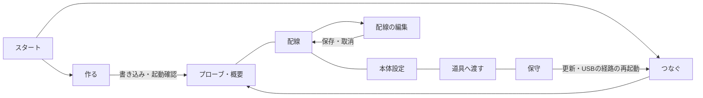

# OEP Probe Tool — 画面仕様

状態: ブラウザのページ（`web/`）の基準。実装と実機での確認の状況は[受入条件](page-acceptance.ja.md) §3 にある。

- [接続・書き込み引継ぎ仕様](page-connection.ja.md): 書き込みから同じ機器・端子で続ける条件、状態遷移、復旧。
- [受入条件](page-acceptance.ja.md): 場面ごとの判定と、実機で残る確認。
- プロトコルの正は[oep-spec](https://github.com/Open-Embedded-Probe/oep-spec)。本書はWeb製品の要件であり、OEP共通仕様を追加しない。

## 1. ページの役割

手元のボードをOEPのプローブにし、設定して保守し、作業をする道具へ渡すための道具。
プローブを使ってする作業そのもの（デバッグ、ログの読み書き、バス・信号・相手役、波形の取得、自動試験）はしない。
その作業はIDE、oep-client-python、WireSkeinが行い、このページはそこへ渡す情報を出す。
OEPの紹介はスタート画面の数行と資料へのリンクだけにし、詳しい説明はOEPの各文書を正とする。

### 1.1 場面

| ID | 場面 | このページですること |
| --- | --- | --- |
| U1 | プローブを作る・更新する | ボードを選び、書き込み、起動を確かめ、そのまま使い始める。接続中のプローブのファームを更新する |
| U2 | つながるか、何ができるかを確かめる | 接続し、個体・ファーム・経路・宣言された機能を見る。問題の切り分けに宣言と保存の状態を出す |
| U3 | 設定し、控えて戻す | ピンの待機状態・使わせないピン、ログの素通し、Wi-Fi、USBの経路を設定し、保存する。設定とメモを控え、戻す |
| U4 | ターゲットへの配線を登録して確かめる | 配線を登録・編集する。相手が決まっていれば型番も残し、ボードを差し替えるコネクタなら型番を空けて、つなぐたびに接続確認で相手を見る |
| U5 | 作業をする道具へ渡す | 用途ごとに道具と渡す情報（アドレス、コマンド、設定ファイル）を出し、このページの接続を終えて渡す |

扱わないもの: 配線が分からない相手の探索（スキャン）、複数台のまとめた管理、ベンチの台帳・電源、通信速度の引き上げ。

### 1.2 原則

- **プローブが中心**: つないだ後は1台のプローブの画面にまとめ、個体・状態・未保存の変更・接続の終了をいつも同じ場所に出す。
- **保存は一か所**: 設定の変更は各項目の「適用」でその場で効く。未保存の変更があれば、プローブの帯に「未保存の変更あり（再起動で消えます）」と「保存」を出す。保存は本体の現在値全体を保存する（core §13）。
- **勝手に動かさない**: 画面を開く・移動する・保存するだけで、attach、ピンの割当、出力をしない。attachは利用者が求めた接続確認のときだけで、その場でdetachする。
- **プローブの宣言に従う**: 選べる方式・ピン・設定は接続したプローブの宣言から出す。宣言の無い項目は出さず、無いことを失敗と扱わない。
- **文はこのページが本当にすることだけ**: 道具がする作業を、このページでできるように書かない。

## 2. 画面

| ID | 画面 | URL | 中身 |
| --- | --- | --- | --- |
| S1 | スタート | `/` | §3 |
| S2 | 作る | `/make`、`/make/prepare`、`/make/review`、`/make/writing`、`/make/continue` | §4 |
| S3 | つなぐ | `/connect` | §5 |
| P1 | プローブ・概要 | `/probe` | §6.2 |
| P2 | プローブ・配線 | `/probe/wiring` | §6.3 |
| P3 | 配線の編集 | `/probe/wiring/new`、`/probe/wiring/<接続名>` | §6.4 |
| P4 | プローブ・本体設定 | `/probe/settings` | §6.5 |
| P5 | プローブ・ほかの道具で使う | `/probe/tools` | §6.6 |
| P6 | プローブ・保守 | `/probe/maintenance` | §6.7 |

上の帯はどの画面でも、ロゴ（S1へ）、言語の選択、接続中なら「プローブへ」を持つ。
未接続でP1〜P6を開いたときは、その画面へ戻る約束でS3へ案内する。
ブラウザが機器のAPIを持たない・HTTPSでないときは、帯の下に理由を出す（読むことはできる）。

## 3. スタート（S1）

1. 一文: 「手元のボードを、組み込み開発の共通プローブに。」と、このページですること（作る・設定する・道具へ渡す）を2〜3行で。
2. 主な2つの入口: 「ボードをプローブにする」（S2）、「プローブにつなぐ」（S3）。
3. このブラウザで最近使ったプローブ（個体ID、ボード）。記録はこのブラウザだけにある。
4. 「OEPでできること」の表: 用途（デバッグ、ログ、波形、センサ・周辺IC、信号、相手役）ごとに、このページで準備すること・作業をする道具。
5. 資料へのリンク（OEPの考え方、ボードとピン、仕様、ファーム、Python、WireSkein、JS）。

## 4. 作る（S2）

導入は一続きの手順にし、上に段階（ボードを選ぶ → 機器を選んで確認 → 書き込み・起動 → 完了）を出す。

1. **ボードを選ぶ**（`/make`）: ボードのカード（推奨のESP32-P4を先頭、Pico/Pico 2、classic ESP32、S3/C3/C6の持ち込み、導入済み向けのCH32）。カードには向く用途、主な機能、導入方法、必要な端子、制約。カード全体を押すとそのボードで次（機器を選ぶ）へ進む。別の「次へ」のボタンは置かない。導入済み向けのカードはつなぐ（S3）へ。ボードごとの機能の比較表は折りたたみで。
2. **機器を選ぶ**（`/make/prepare`）: 最初にすること（BOOTSELなど）を示し、書き込み先を一度だけ選ぶ。ESPはROMからチップとrevisionを読み、配布イメージを決める。接続方式を選ばせない。
3. **確認**（`/make/review`）: 検出したチップ、ファームの版、書き込む範囲、設定の扱いを見せて実行する。
4. **書き込み・起動**（`/make/writing`）: 書き込みから起動確認まで一続きの進行表示。書き込み中は移動させない。
5. **続ける**（`/make/continue`）: 書き込めたがOEPの応答をまだ確かめられないとき。書き直さず、同じ機器での再試行、起動した機器の許可、抜き差しを案内する（[接続引継ぎ仕様](page-connection.ja.md)）。
6. 完了したらP1へ進み、「導入できました」と最初にすること（P1の「次にすること」）を出す。

## 5. つなぐ（S3）

- このブラウザで許可済みのOEPのUSB機器を並べ、選ぶとそのまま接続する（個体IDでdescribeのunit_idを確かめる）。
- つなぎ方ごとに選ぶ: 「USBシリアル」（Web Serial。USB-UART変換かCDC。classic ESP32、P4の書き込みに使ったポート）、「USB（OEPの機器）」（WebUSB、vendor bulk。Pico、P4のnative USB、CH32など）、「USB HID」（WebHID。上のUSB機器を開けないとき）。それぞれに、どのボードがその口かを書く。ボードの種類は選ばせない。
- 一覧に出ないときの確認（データ用ケーブル、起動、ほかのアプリ）と、まだ導入していない場合のS2への入口。
- 接続後は、呼出元（未接続で開いたP1〜P6）か、P1へ進む。

## 6. プローブ（P1〜P6）

### 6.1 プローブの帯とタブ

帯: ボード名・個体ID・ファームの版・経路、変更権の有無、未保存の変更と「保存」（§1.2）、「接続を終了」。
経路がひとりでに閉じたとき（ケーブルが抜けた、プローブがリセットされた、読み取りの誤り）は、その場でプローブを忘れ、今いる画面に「接続が切れました」と理由、もう一度つなぐ入口を出す。つなぎ直すと同じ画面へ戻り、すべて読み直す。書き換えは自動で送り直さない。保存していない設定は電源が切れていれば消えていると示す。
タブ: 概要／1 配線／2 本体設定／3 ほかの道具で使う／保守。番号は進める順。概要・配線・本体設定の下には、次の段階へのボタン（「次へ」）を置く。

### 6.2 概要（P1）

- 個体: ボード、個体ID、ファームの版と配布版との比較（新しい版があればP6へ）、経路。
- 3つの段階（1 配線、2 本体設定、3 ほかの道具で使う）を、それぞれ何をする所か・今どうなっているか（登録した配線、素通し・待機ピン・Wi-Fi・未保存の変更）・開くボタンとともに並べる。導入の直後はここに「導入できました」を出す。
- このプローブの機能: 宣言されたインターフェースの名前の一覧。

### 6.3 配線（P2）

- 接続先の一覧: 接続名、相手の型番（無ければ「差し替えて使うコネクタ、または未記入」）、信号のまとまりごとに1行（種類、ピン）、メモ、アドレス `oep://<個体>/<接続名>`、保存先（プローブのメモ領域か、このブラウザだけか）。
- 各接続先に「編集」「削除」。削除は名前・ピン名・記録への影響を示して確かめる。
- 「新しい配線を登録」。空のときは作り方の例を出す。設定を変更できないプローブでは読み取りだけと示す。

### 6.4 配線の編集（P3）

新規・編集で同じ形にし、上から「名前・相手の情報」「信号とプローブ側のピン」の順に置く。新規は信号の無いところから始め、この画面で信号（デバッグ、UART、I2C、SPI、そのほかの信号）を追加する。種類を先に選ぶ別の画面は置かない。
信号のまとまりは、追加した順によらず、いつも デバッグ・UART・I2C・SPI・そのほかの信号 の順に並べる。
入力は打つたびに確かめ、接続名の誤りはその欄の下に、ほかの誤りは保存の上に、どの信号の何が悪いかを書いて出す。誤りがある間は保存できない。名前の前後の空白は保存のときに外す。
信号を追加すると、加わった欄を画面の見える位置へ動かす。

| 項目 | 説明・入力支援 | 検証 |
| --- | --- | --- |
| 信号とピン | 種類ごとのまとまりを複数持てる。ピンの候補はプローブの宣言から。UARTはRX←相手TX、TX→相手RX | 候補、固定グループ、同じ配線の中の重複、ほかの接続先との衝突 |
| デバッグの方式 | SWD／2線RVSWD／1線DIO（SWIO）。プローブが宣言しない方式は選べない | — |
| 接続確認（デバッグ） | 任意。そのピンで一度attachし、応答したID（RVSWD/SWIOはDMSTATUS、SWDはDPIDR。SWDで応答が無ければRP2040のmultidropのcore 0も試す）を見せてdetach | 結果は保存の条件にしない。方式・ピンを変えたら結果を消す |
| 相手側のピン名 | 任意（`@相手ピン`）。たたまずに出す | 文字種は host guide §5.3 |
| 接続名 | アドレスに使う名前。変更時はアドレスが変わることを示す | 英字で始まる16文字以内の英数字・ハイフン、大文字小文字を区別せず重複を拒む |
| 相手の型番・メモ | 任意。ずっとつなぐ相手なら型番を、ボードを差し替えるコネクタなら空欄に、と欄の説明で案内する。型番は接続確認の結果ではない | ラベル全体は32 byte以内 |

- 保存はピンのラベルを適用して本体を保存し、型番とメモを `oep.probe.memo/port/<小文字の接続名>` に書く。デバッグの方式（swdio / swclk が RVSWD か SWD か）は `io.github.open-embedded-probe.web/port/<小文字の接続名>` に書く（oep-if-memo §4.1）。メモ領域の無いプローブでは、このブラウザに置き「このブラウザだけ」と示す。
- 永続保存のできないプローブでは「今回だけ適用」と示す。
- 速度・アドレスなどの通信条件は配線に保存しない（作業をする道具で指定する）。
- 保存前に今の値を読み直し、編集を始めてからの変更と衝突すれば入力を保ったまま知らせる。
- 未保存の入力があるまま離れるときは「編集を続ける／破棄して移動」を確かめる。

### 6.5 本体設定（P4）

はじめに、この画面で設定できる項目の一覧を、何をするものか・今の状態とともに出し、押すとその項目へ移る。項目ごとに今の値と「適用」を持ち、保存は帯で行う（§1.2）。

| 項目 | 中身 |
| --- | --- |
| ピン | ピンごとの待機状態（Hi-Z、pull-up、pull-down、Low、High）と使わせない指定。空いているピンにはすぐ、使用中のピンには解放したときに効くと示す |
| ログの素通し | セッションの無い間、相手のUARTかデバッグ線（WCH）のログをプローブのシリアルポートへ流す。入力元、登録済みの配線から、受けるピン、速さ・形式（デバッグ線は方式とsdi/dmdata/dmseq）、出力ポート。今の素通しの一覧と外す操作。相手→PCの一方向 |
| ネットワーク | Wi-Fiを宣言するプローブだけ。SSIDとパスフレーズ（秘密の値は表示も控えへの書き出しもしない。空欄は今の値のまま）。状態の表示。このページからTCPで接続できるとは書かない |
| USBの経路 | `usb.transports` を宣言するプローブだけ。宣言された組み合わせから選び、「保存して再起動」。再起動後はS3で選び直す |
| すべての設定値 | 詳細として、分類・項目・値の一覧と、任意の項目の適用・解除 |

### 6.6 ほかの道具で使う（P5）

はじめに「このページは準備まで。作業はここに並ぶ道具で行う」と書く。用途の順に、使う道具と渡す情報を出す。登録した配線があれば、そのアドレスで示す。方式の分からないデバッグの配線（swdio / swclk は SWD にも RVSWD にもなり、記録が無い）は、CH32 にもブローカーにも出す。

1. **デバッグ・書き込み**: CH32はArduinoCore-CH32RVのポートに `oep://<個体>/<接続名>`。RP2040（SWD）はブローカーの起動の行と `debug_custom.json`。ほかはPython。ESP32とJTAGは無いと示す。
2. **ログ**: 素通しを設定したポートとシリアルモニタでの開き方。素通しが無ければP4へ。送信もするならPython。
3. **波形**: WireSkeinでの取得（Python）と、取得済みファイルの公開Viewer。
4. **センサ・信号・相手役・自動試験**: oep-client-pythonでのアドレス（`oep://<個体>`、`oep://<個体>/<接続名>`）と `oep dump`。
5. **このページでの利用を終える**: 変更権と接続を解放して渡す。資料を読むだけなら終えなくてよい。

### 6.7 保守（P6）

- **ファームの更新**: 配布版との比較、方式（P4/P4XはDFU、RP2はboot ROM）、更新前の控えの勧め、進行。更新後はS3で同じ個体を選び直す。classic ESP32とCH32はこのページから更新できないと示す。
- **設定とメモの控え**: OEPの設定のファイル（oep-spec docs/oep-settings-file.ja.md。メモ欄は §2.4 の `memo`）1つに書き出す（秘密の値は含めない。壊れた記録と名前が文字でない記録は入れずに示す）。戻すときは適用の前に差分（別の個体の控えか、適用する・解除する値、書く・消すメモの記録、この個体に無いもの、秘密の値の不足）を見せる。メモ欄を含むファイルはメモ欄をファイルのとおりにする（無い記録は消す）。
- **診断**: 経路、個体ID、機能の数、保存の状態、宣言の全文（文とJSONで保存）、メモ領域の記録。壊れた記録があっても配線のラベルは消さない。

## 7. 共通の決まり

- **言語**: 日英。既定はブラウザの言語、帯の選択で切り替え、このブラウザに覚える。切り替えても入力・画面・接続を保つ。
- **URL**: 戻る／進むと直接のURLを扱う。旧URLは新しい画面へ移す（[受入条件](page-acceptance.ja.md) §4）。
- **狭い画面**: 390px幅で横にはみ出さない。タブは折り返す。
- **失敗の書き方**: 何が完了し、何ができず、次に何を押すかを近くに出す。
- **相手の文字列**: HTMLとして挿入しない。秘密の値をログや控えに出さない。
- **変更権**: 状態を表示し、変更する操作の中で取る。強制的に奪わない。
