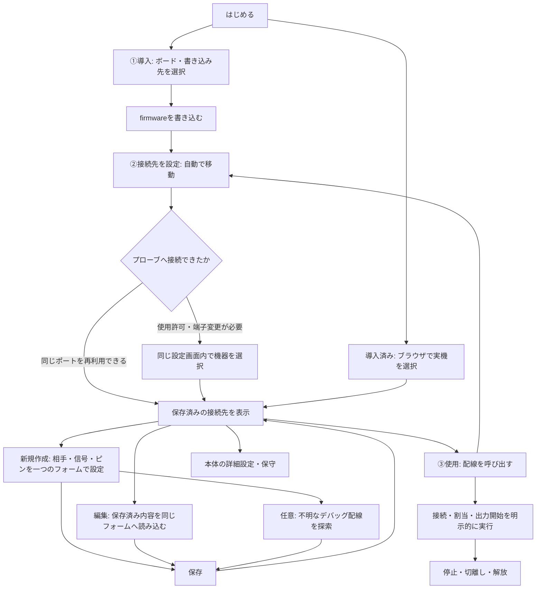

# OEP Probe Tool の仕様・画面遷移

## 1. 目的と基本モデル

このページは、新しいボードへのOEP導入から、接続先の配線設定、信号・デバッグ操作までをブラウザで行う作業場所である。
画面の主導線は **①導入 → ②接続先を設定 → ③使用** の3段階とし、各画面に現在位置と前後の段階を示す。
導入済みの場合は②から、一時的な調査で登録が不要な場合は③から開始できる。

利用者に区別してもらう対象を次の3つに絞る。

| 対象 | 意味 | 設定・操作の内容 |
| --- | --- | --- |
| プローブ | ブラウザにつなぐOEPボード | firmwareの導入、本体の待機状態・ネットワークなどの設定 |
| 接続先 | プローブの先につなぐIC・基板と、再利用する配線の名前 | 接続名、相手の型番、用途メモ、信号とプローブ側ピンの対応 |
| 現在の操作 | 実際に相手へ接続・出力している状態 | ピン割当、バス設定、信号送受信、デバッグの接続・切離し |

接続先の保存は、ターゲットへの接続やピン出力を開始しない。
型番やメモは人が相手を識別するための記録であり、ターゲットの自動識別結果ではない。
プローブには接続して設定する。ターゲットは未配線・未通電でもよい。プローブ未接続のオフライン編集は対象にしない。

根拠は `oep-core §13`（設定・label・保存）、`oep-if-memo §4.3`（接続先の記録）、各wire/fixtureの宣言である。
特にlabelは名前であり、probeはその名前で線を駆動しない。実行可能な機能・ピンは接続した実機の宣言を使う。

## 2. 主なユースケース

| 状況 | 開始位置 | 完了条件 |
| --- | --- | --- |
| 初めてボードをプローブにする | ①導入 | 書き込み後、自動で②へ進み、同じ設定画面で配線を登録できる |
| OEP導入済みのプローブを使う | 実機選択 → ②設定 | ボード名を事前に選ばず接続し、既存の接続先が見える |
| 治具・コネクタの配線が決まっている | ②設定 → 新規作成 | 役割ごとの固定ピンを、ターゲット未接続のまま保存できる |
| UART/I2C/SPIの配線を繰り返し使う | ②設定 | 相手と配線に名前を付け、使用画面に呼び出せる |
| 配線、接続名、相手の型番が変わった | ②設定 → 接続先の編集 | 一つのフォームで編集・保存し、一覧に更新内容が見える |
| デバッグ配線が分からない | 新規作成 → 任意の探索 | 絞った候補ピンで応答を探し、結果を接続先として保存できる |
| 一時的な調査で保存が不要 | ③使用 | 信号/デバッグ画面で直接ピンを指定して操作できる |
| 待機状態やネットワークを変える | ②設定 → 本体の詳細設定 | プローブ本体の設定を適用・保存できる |
| 波形を取得・解析する | ③使用 → WireSkein | 対応機能と個体を確認してWireSkeinへ進める |

## 3. 画面と遷移

| 画面 | URL | 主な内容と次の操作 |
| --- | --- | --- |
| はじめる | `#home` | 新規書き込みを主操作とし、導入済みの接続も案内する |
| ①導入 | `#firmware` | ボード比較、書き込み先、画像、進行・ログ。成功時は自動で②へ |
| 実機の選択 | `#connect` | ブラウザの機器一覧を開く。接続後は②へ。要求元がある場合は元の画面へ復帰 |
| ②接続先を設定 | `#setup` | 接続待ち・書き込み結果、接続先の一覧、新規作成、編集、使用画面への呼出、本体の詳細設定への入口 |
| 接続先を作成 | `#target/new` | 相手の名前・型番・メモ、信号/系統、役割ごとのピン、保存。保存後は②へ戻る |
| 接続先を編集 | `#target/edit/<名前>` | 既存値を読んで同じフォームで編集。保存・キャンセルとも②へ戻る |
| ③使用 | `#probe` | 接続個体と機能、信号/デバッグ/波形の作業。②へ戻って設定を編集できる |
| 信号を操作 | `#signals/<機能>` | 配線の呼出、ピン割当、通信条件、送受信・停止・解放 |
| ターゲット操作 | `#debug` | 配線の呼出、明示的な接続・切離し、制御・メモリ・レジスタ・コンソール |
| 波形・道具 | `#tools` | WireSkeinなどへの案内と個体別のコマンド |
| 本体の詳細設定 | `#settings` | 待機状態・ネットワークなどの設定、適用と永続保存、ファイル控え・復元 |
| 保存領域 | `#storage` | メモオブジェクトの一覧とファイルの入出力 |
| 診断 | `#diagnostics` | 宣言、通信の状態、速度検査、操作履歴 |
| 案内・比較 | `#help` | OEP、ボードの特徴、配線・ブラウザ・資料 |

旧 `#targets` は②と同じ内容を表示する。その他の旧URLも対応する画面へ案内する。
サイドバーは「準備」「使用」「詳細・保守」「案内」に分ける。詳細の生の設定項目を、初回導入後の主画面にはしない。

## 4. 書き込みから設定への引継ぎ

- 初回書き込み前にOEPとして接続する必要はない。
- ESP32/P4/P4Xはサイト内に同梱したesptool-jsとWeb SerialでROM書き込みする。配布画像のSHA-256とチップIDを検証し、実チップ・P4 revisionとの不一致を拒否する。
- S3/C3/C6は対応merged画像の持ち込み。配布画像がないことを明示する。Pico/Pico2はBOOTSELでWebUSB書き込み。CH32の初回書き込みは未対応と明示する。
- 書き込み成功時は②へ自動で移る。以前のOEPセッションは再利用しない。
- シリアルでは書き込みに選んだポートを再利用し、再起動を待って接続を試す。USBでは同じ個体と確認できる許可済み機器だけを自動で開く。別の許可済みプローブを勝手に開かない。
- 新しいUSB機器への許可や端子変更が必要な場合も、②の中で説明・選択する。ブラウザの使用許可は自動化できるものとして扱わない。
- 再接続失敗は書き込み失敗と分ける。書き込み完了表示を保ち、同じ画面で接続を続行できる。再接続のために再度書き込ませない。
- 接続時にプローブのボード名を尋ねない。実機からモデルと能力を読む。USB/Serial/HIDの3択を初手に置かず、別端子の利用は説明付きの補助操作にする。

## 5. 接続先のフォーム

フォームは次の順にする。新規作成と編集で項目の意味や保存手順を変えない。

1. **何をつなぐか**
   - 接続名: `sensor`、`board-1`など。アドレスとピン名の接頭辞になる。英字で始まる16文字以内の英数字・ハイフン。変更するとアドレスも変わる。
   - 相手のIC・基板の型番（任意）: `CH32V003F4P6`、`STM32F103C8T6`、モジュール名など。相手を人が識別する記録。プローブの型番や、自動識別の入力ではない。
   - 配線・用途メモ（任意）: コネクタ番号、電圧、用途、注意点など。
2. **どの信号を使うか**
   - 実機が宣言するデバッグ線、UART、I2C/SPI、GPIO/PWMなどを説明付きカードで選ぶ。複数系統を区別する。
   - RVSWDはWCH RISC-V、SWIOはCH32V00x、SWDはARMなど、選ぶ理由を示す。
   - 他の道具で作った独自の信号名も編集・保持できる。
3. **プローブのどのピンを使うか**
   - 役割別の候補と現在の名前を表示する。UARTはプローブRX←相手TX、プローブTX→相手RXを明示する。
   - 固定グループ、候補の交差条件、ピン重複を検証する。未割当への変更はその信号の削除。
4. **保存またはキャンセル**
   - 保存操作に伴って設定変更権を取得する。入力開始前に別の権限取得操作を要求しない。
   - 保存後は②の一覧へ戻り、更新結果・型番・メモ・配線を表示する。
   - キャンセルは未適用の入力を破棄して②へ戻る。

### 保存と編集の整合性

- 配線はcoreのピンlabelとして保存する。SCAN/ATTACH/PLAN_APPLYを呼ばない。
- 型番・メモは、対応プローブでは`oep.probe.memo/port/<名前>`へ保存する。未知のメンバーは保持する。
- メモ領域がない場合はブラウザ内に個体・接続名別で保存し、その保存先を入力欄の近くで説明する。
- 名前変更時は記録も新名へ移す。配線変更で古くなる確認済みターゲットの記録は取り除く。
- 編集で変更できるのはその接続先のlabelだけ。他の接続先のピン・名前を上書きしない。
- ピン移動時は古い重複labelを解除してから新しい対応を設定する。不要になった古いピン名を残さない。
- 保存直前に実機を再読込し、編集開始時から配線が変わっていたら保存を止めて再読込を求める。
- 適用・永続保存・メモ保存は別の処理。途中失敗はどこまで進んだかを説明し、設定を読み直す。全成功と表示しない。
- プローブのsaveは全現在値を保存するため、他に未保存の変更がある場合は説明する。永続保存非対応ならその旨を示す。
- 削除は対象と影響を確認し、ピン名と記録を削除する。

## 6. 使用・保守と共通動作

保存した配線を使用画面に呼び出しても、接続・割当・出力は始めない。使用する機能を選び、その画面で開始する。
現在接続中のターゲットを別配線へ勝手に付け替えない。停止・切離し・解放を明示する。
GPIO/UART/I2C/SPI/PWM/カウンタ/DAC、RVSWD/SWIO/SWDの既存機能は維持し、実機の宣言にない操作を出さない。
キャプチャの取得・解析はWireSkeinへ案内する。ターゲット固有のflash書き込みと、プローブ自身のfirmware導入は区別する。

接続や入力は画面移動で不用意に失わない。URL直接指定、戻る・進む、日本語・英語、狭い画面に対応する。
変更権は所有者を尊重して取得し、強制取得しない。セッション喪失後は一時的な割当・接続を破棄し、変更操作を自動再実行しない。
機器名や入力ファイルの文字列をHTMLとして挿入しない。秘密の設定値を表示・履歴へ出さない。
主要ボタンは50px、入力欄は52px以上を基準にし、説明を削って小さな操作部品に押し込めない。

## 7. 確認

- 書き込み成功から②への自動遷移、同じシリアルポートの再利用、再接続失敗・USB許可待ちでも②で続行できること。
- 同じ個体と判断できない別の許可済みUSB機器を自動で開かないこと。
- 新規作成・編集・名前変更・ピン移動・削除・キャンセルと、他の接続先との衝突拒否。
- 型番・メモの読込と更新、保存先の説明、未知の記録フィールドの保持。
- 保存・配線の呼出でターゲットへ接続せず、ピンも駆動しないこと。探索非対応でも登録できること。
- 全体の通信試験、型検査、サイトビルド、Chromiumでの表示と操作。実機のUSB権限・電気的な信号・書き込み確認は別に報告する。
