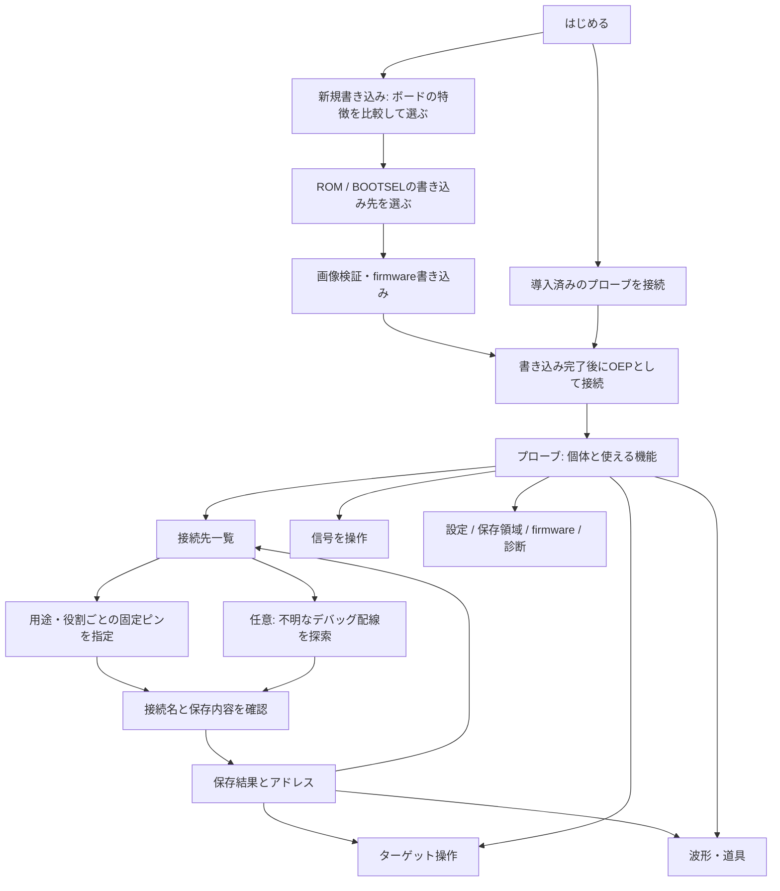

# OEP Probe Tool の要件と画面設計

## 1. このページで終えられる仕事

OEP Probe Tool は、OEP プローブを導入し、接続したプローブとその先の機器を、ブラウザから設定・操作する作業場所である。
主導線は新しいボードへの firmware 初回書き込みとし、既にプローブを持つ人は接続してすぐ作業を選べる。
機能を使うために仕様の fn/op 番号を覚える必要はない。

利用者が終えられる仕事を次のように定める。

| 仕事 | 完了の条件 |
| --- | --- |
| プローブを準備する | 対応ボードと導入方法を選び、firmware を書き、OEP プローブとして接続できる |
| 状態を知る | 個体、firmware、接続経路、使用できる機能、変更操作の可否が分かる |
| 接続先を登録する | ターゲット未接続でも役割ごとの固定ピンを指定し、接続名・ピン名と任意のメモを保存できる。探索は任意 |
| 信号を操作する | 対応する GPIO、UART、I2C/SPI の主・相手、PWM、カウンタ、DAC を設定し、実行結果を確認できる |
| ターゲットを調べる | RVSWD/SWIO/SWD で接続し、対応するデバッグ操作、メモリ・レジスタの操作、コンソールが使える |
| 波形を取得する | プローブの取得機能を確認し、WireSkein の取得コマンドとビューアへ進める |
| 設定を管理する | 宣言された設定を読み書きし、実行中の変更と永続保存を区別し、控え・復元ができる |
| 記録を管理する | メモ領域の一覧・読み書き・削除とファイルの入出力ができる |
| 保守・問題の調査 | firmware の更新、宣言の確認と保存、シリアル速度の検査、操作履歴の確認ができる |

キャプチャの取得・表示・復号・照合は WireSkein を使う。ターゲット固有の flash 書き込みはデバイスに対応する外部ツールに渡す。
このページはプローブ自身の firmware を更新できるが、それをターゲットの flash 書き込みと混同しない。

## 2. 参考実装から採るもの

- `wireskein-web/web/`: 最初の画面に主な操作を置く。入力後は結果を中心にし、操作のすぐ近くで状態を示す。
- `ESP32SerialCtl/docs/`: 接続状態を常時表示し、接続した機器の操作を用途ごとに切り替える。フォームと結果を同じ場所に置く。
- OEP 固有の要件: ボード名の静的な対応表より、接続したプローブが宣言する機能・revision・操作・ピン候補を優先する。

紹介記事をスクロールし続けないと作業へ進めない構成は採らない。OEP の概要、ボードの比較、ドキュメントは独立した案内から読める。

## 3. 画面と URL

共通のヘッダーに接続個体・状態、変更権の取得/解放、切断、言語を置く。左のナビゲーションを用途の切替に使う。
狭い画面ではナビゲーションを横に並べる。画面移動で接続・入力・結果を失わない。戻る/進むと URL の直接指定を使える。

| 画面 | URL | 内容・主な次の操作 |
| --- | --- | --- |
| はじめる | `#home` | 主操作は「新しいボードにOEPを書き込む」。書き込み済みの場合の接続は別の入口。短い目的説明、ブラウザの対応状況 |
| プローブに接続 | `#connect` | ボードの事前選択なしでブラウザの一覧から実機を選ぶ。接続後にモデルと能力を読む。許可済みUSB機器は個体IDから選べる |
| プローブ | `#probe` | 個体と能力、登録された接続先、目的別の作業への入口 |
| 接続先 | `#targets` | 保存された接続名・配線・メモ・アドレス。登録された配線は現在の接続検出結果とは区別する |
| 接続先を追加 | `#target/new` | 固定ピン指定→確認・命名と保存→完了を標準とする。未知の配線だけ任意で探索する |
| 信号を操作 | `#signals/<機能>` | 宣言された機能/インスタンスを選び、ピンを割り当て、設定・送受信・停止・解放する |
| ターゲット操作 | `#debug` | 線とピンを選んで接続。接続中のターゲットの制御、メモリ、レジスタ、コンソール |
| 波形・道具 | `#tools` | WireSkein、CH32 用ツール、Python。接続中の個体を入れたコマンド、コピー |
| 設定 | `#settings` | 現在値、宣言に沿った編集、未保存の表示、永続保存、ファイルの控えと復元の差分確認 |
| 保存領域 | `#storage` | メモオブジェクトの一覧、テキスト編集、バイナリのファイル入出力、削除 |
| firmware | `#firmware` | 初回導入と接続中プローブの更新。ボード/画像/版/手順、進行、再接続 |
| 診断 | `#diagnostics` | 全宣言のテキスト/JSON保存、シリアル速度検査、操作履歴 |
| 案内 | `#help` | OEP の概要、ボード比較、配線/ブラウザ/外部ツールの説明と資料 |

旧 URL `#target`、`#try`、`#details`、`#start`、`#boards` などは対応する新しい画面へ転送する。

## 4. 主要な画面遷移

- 接続が必要な画面を未接続で開いた場合、その画面の目的と接続の入口を表示する。ブラウザの一覧で実機を選び接続した後は元の画面へ戻る。
- USB/シリアル/HIDの3択やボード名の選択を最初に求めない。主操作はOEP USBの機器選択。シリアルとHIDは機器が現れない場合の説明付きの案内へ置く。シリアル書き込み直後は同じ経路の接続を主操作にする。ボード比較は導入と案内だけに置く。
- ボード、デバッグ線、入出力の系統は選択肢と説明が常に見えるカードで選ぶ。ボードは用途、対応機能と上限、導入方法、検証状況を比較できる。機能の系統は宣言された上限・ピン候補数と現在の割当状態を示す。
- 接続直後は読み取り専用。変更操作のある画面には「変更操作を有効にする」と、その間のピン占有の説明を置く。
- 他のホストが使用中なら所有者とエラーを表示し、強制取得はしない。
- 変更権を解放すると一時的なピン割当・出力・ターゲット接続が終了する。保存済みの設定/接続名/記録と区別する。
- 切断や再起動/セッション喪失後は、一時オブジェクトと画面上の有効状態を破棄する。状態を変えた要求を自動で繰り返さない。

## 5. 各作業の要求

### 配線を設定するユースケース

ここで「未接続で設定する」は、プローブには接続しているが、ターゲットは未配線・未通電でよいことを意味する。
プローブ自体が未接続のオフライン下書きは対象にしない。実機の宣言からピン候補・固定グループ・設定の保存可否を得る。

| 状況 | 設定する内容と目的 | 操作の流れ |
| --- | --- | --- |
| 配線図・コネクタ・治具のピンが決まっている | SWDIO/SWCLKやSWIOなどに固定ピンを割り当てる名前を保存し、後で繰り返し使う | 用途と役割別ピンを指定→確認・名前を保存→必要になったらターゲット接続 |
| UARTでログ取得・送受信する | プローブRX←ターゲットTX、プローブTX→ターゲットRXの対応を保存する | RX/TXのピン名を保存→UART画面へ呼び出し→明示的に割当・通信設定 |
| I2C/SPI機器を繰り返し調べる | SDA/SCLまたはSCK/MOSI/MISO/CSの対応を保存する | ピン名を保存→選んだ系統の操作画面へ呼び出し→明示的に割当・バス設定 |
| GPIO/PWMなどの試験治具を用意する | 宣言された役割とピンの対応に名前を付ける | 配線を保存→操作画面へ呼び出し→設定・開始を明示的に実行 |
| デバッグ線の対応が分からない | 絞った候補ピンの組を試し、応答のあった配線を登録する | 任意の探索モード→GND/給電確認→候補を探索→結果を選んで保存 |
| 一時的に調べるだけ | 保存された接続名を作らず、その場だけ使用する | 信号/ターゲット操作画面から直接ピン指定→明示的に開始→停止/解放 |

### 接続先の登録

1. 標準は「決まっているピンを指定」。プローブが宣言するデバッグ線または信号機能と系統を選ぶ。SCAN操作の有無は登録条件にしない。
2. 役割ごとにピンを指定する。候補・固定グループ・重複を検証し、既存のピン名を無断で置き換えない。編集・確認だけなら変更権も不要。
3. 接続名・型番・メモと実際に保存される信号名→ピンの一覧を確認する。ターゲット動作未確認と明示する。
4. 変更権を取得してピン名を設定・永続保存する。保存はSCAN/ATTACH/PLAN_APPLYを呼ばず、ピンを占有・駆動しない。メモは対応するプローブにのみ保存する。途中失敗を完全成功と表示しない。
5. 保存できた範囲とアドレスを表示する。登録済み配線は実機の候補と照合した上で、対応するデバッグ/信号機能のフォームへ呼び出せる。フォームへの読込と実際の接続/割当/出力は別操作。
6. 探索は独立した選択肢とする。選んだ候補ピンだけを試し、検出ゼロも明示する。ピン選択や方法を変えたら以前の結果を破棄する。

保存された配線は、ターゲットの存在・給電・現在の接続・動作を保証するものではない。スキャン結果も探索時点の応答として扱う。

### 信号を操作

機能ごとに「ピン割当」「設定」「操作と結果」「停止/解放」を持つ。別の画面に移動しても出力を勝手に止めず、
共通の変更権表示と割当表示から終了できる。非対応機能は理由を表示し、実行しない。

- GPIO: ピンとモードの設定、レベルの読み取り、割当解放。
- UART: インスタンス、RX/TX、baud、設定、テキスト/hex送信、受信、表示クリア、割当解放。
- I2C 主: SDA/SCL、clock、stretch timeout、アドレス、write/read/write-read、結果と NACK の区別。
- SPI 主: SCK/MOSI/MISO/CS、mode/order/clock、hex送受信と実際に採用された値。
- I2C 相手: アドレス設定、応答データの投入、受信フレームと待ち数/エラーの確認。
- SPI 相手: mode/order、応答データを置いて受信待ち、受信bit数とデータ、状態確認。
- PWM: ピン、周波数、duty、出力開始、停止、採用された値と状態。
- カウンタ: ピン、計測窓とエッジ、実際の窓時間と計数。
- DAC: ピン、宣言されたbit数/電圧範囲、raw値の設定、状態、解放。

### ターゲット操作

RVSWD/SWIO/SWD、宣言されたピンと速度を選び、接続/切離しを明示する。
RISC-V は停止・再開・step・reset、メモリ読み書き、レジスタ読み取り。ARM は ADI/MEM-AP と Cortex-M の停止・再開・reset、
メモリ読み書き、レジスタ読み書き。対応する操作だけを有効にする。console は利用可能な方式を選んで開き、読み書きする。
書き込み先/値は操作前に入力欄で明示する。ページを離れても接続中であることを表示する。

### 設定と保存領域

- 設定名・型・選択肢・対象はプローブの宣言を使う。秘密の値を表示/履歴へ出さない。
- 「適用」は現在の設定、「プローブに保存」は再起動後も残す操作として区別する。
- ファイル復元は set/unset・未解決項目・別個体のファイル・値のない秘密項目を適用前に表示する。
- 全消去/オブジェクト削除は対象と影響を表示して確認する。メモのバイナリはテキスト化せず保存できる。

### firmware

初回導入はボードを選ぶ。接続中の更新はプローブが名乗るモデルから画像を選ぶ。P4 と P4X を混同しない。
初回導入の前にOEP接続を要求しない。ESP32/P4/P4XはWeb SerialのROM書き込みで、配布merged画像をoffset 0へ書く。
ESP32のbootloaderは0x1000、P4は0x2000。画像のチップIDと実チップを照合し、P4 v1.x/P4X v3.xの相違は書き込み前に拒否する。
S3/C3/C6は対応merged画像を画面で選んで同じ経路で書けるが、OepProbe配布画像はないことを明示する。
持ち込み画像はbootloaderと0x8000のpartition tableを含むoffset 0の標準構成のみを扱い、app単体を拒否する。
CH32は初回書き込み未対応と明示する。Pico/Pico2はBOOTSELのWebUSB書き込みを維持する。
manifest がない/取得に失敗した場合は配布画像で書き込まず、この画面で再取得できる。配布画像の sha256 を検証してから書く。
USB端子、BOOT/RESETの操作、ポートの選択、進行とログを同じ画面に置く。完了/失敗後はシリアルポートを解放する。
書き込み中は二重実行と画面からの再実行を防ぐ。完了後は再接続を明示し、以前のセッションを再利用しない。

## 6. 共通の動作と表示

- 英語/日本語。初期値はブラウザの言語、手動選択を保存する。機器の名前、ユーザー入力、ログの技術情報は翻訳しない。
- 接続待ち、読込中、実行中、成功、部分失敗、失敗、未対応、空の結果を区別する。結果は実行したフォームの近くに残す。
- 二重実行を防ぎ、処理の開始/終了を操作履歴に残す。通信エラー後に成功状態を残さない。
- 主要ボタンは高さ50px以上、入力欄とプルダウンは52px以上、本文は16pxを基準とする。モバイルでも操作部品を小さくしない。
- 画面の切替はフォーカスを見出しへ移す。フォームにラベルを付け、キーボード操作、狭い画面、OS の明暗設定に対応する。
- スクリプト/外部の文字列を HTML として挿入しない。機器の情報や入力ファイルをサーバーへ送信しない。
- HTTPS/localhost と API の有無を確認し、使えない接続方法には理由を付ける。USB/Serial/HID の違いを説明する。

## 7. 実装と確認

画面は `web/`、通信は既存の `src/`、ボード案内は `web/boards.js`。OEPプロトコルを画面に再実装しない。ESP ROM書き込みだけは固定版esptool-jsをサイト内にbundleし、実行時CDNや外部書き込みサイトへ依存しない。
受入れ確認は未接続の全画面/直接URL/戻る進む/言語/画面幅、仮想プローブでの接続・機能選択・設定・送受信・失敗・セッション解放、
サイトビルドとライブラリの既存検査を含む。実機の USB 権限、電気的な入出力、firmware 書き込みは実機試験として結果を分けて報告する。
