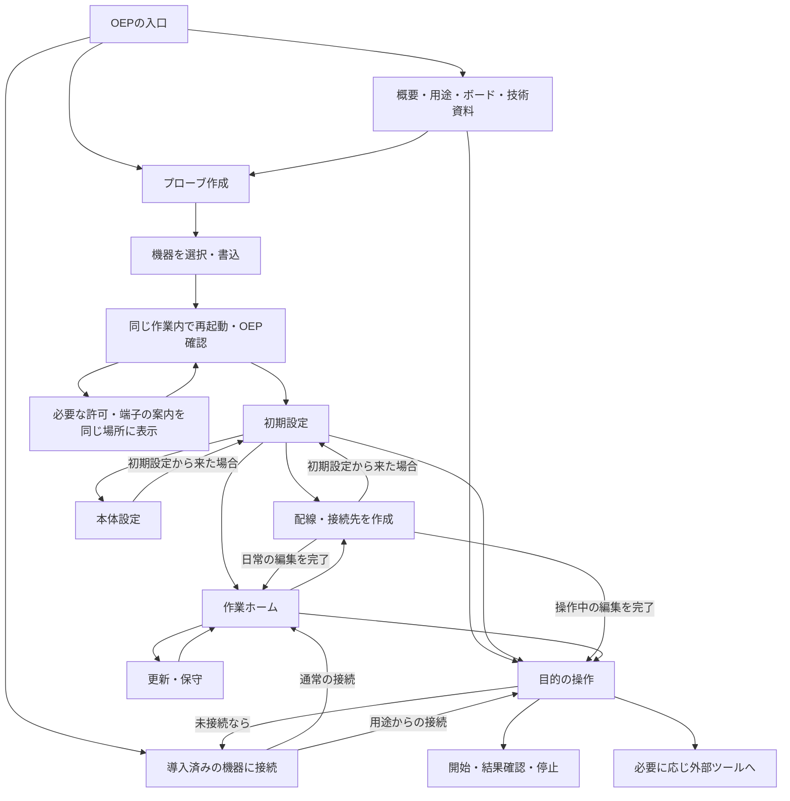

# OEP Web — 要件定義・画面仕様

状態: **次の画面再設計の仕様案**。2026-11-06作成。現行画面の説明書ではない。
この文書を画面実装の基準とし、既存のメニュー、URL、APIフォームの配置から設計を逆算しない。
今回の変更は文書のみ。実装済み・検証済みという意味で「対応」と記載しない。

- [接続・書き込み引継ぎ仕様](page-connection.ja.md): 同じ機器・端子で続行する条件、状態遷移、復旧。
- [受入条件・実装との差分](page-acceptance.ja.md): シナリオ別の判定と、実装前に残る検証。
- プロトコルの正は[oep-spec](https://github.com/Open-Embedded-Probe/oep-spec)。本書はWeb製品の要件であり、OEP共通仕様を追加しない。

## 1. ページの役割と成功条件

OEPの玄関であり、手元のボードをプローブにして使い始める作業場所とする。
初めて来た人が「OEPは何か」「自分の目的に使えるか」「何を用意するか」を、機器を接続せず理解できる。
その理解から、ボードへの導入、必要な設定、最初の操作へ連続して進める。
導入済みの人は説明や初期設定を繰り返さず、前回のプローブと作業へ戻れる。

| ID | 必須要件 | 成功した状態 |
| --- | --- | --- |
| R01 | 読むだけで分かるOEPの入口 | 概要、用途、ボード、仕組み、資料が未接続でも読める |
| R02 | 用途から道具を選べる | 入出力・通信・デバッグ・波形の違いと、自分が次にすることが分かる |
| R03 | 新規プローブをブラウザで作る | 標準導入の対象ボードは、別アプリやCLIのインストールなしで初期設定まで進める |
| R04 | 書き込みと設定を連続させる | 選択済みの機器と端子を引き継ぎ、通常経路で再選択・抜き差し・方式選択を要求しない |
| R05 | 接続時のボード選択をなくす | 導入済み機器の種類・機能は接続後に取得する |
| R06 | 必要な設定だけ行える | 配線登録、待機状態、通信経路などを目的別に選べ、不要な設定は飛ばせる |
| R07 | 相手がいなくても配線を登録できる | プローブだけ接続し、固定ピンと相手の情報を保存・編集できる。スキャンしない |
| R08 | 機能の操作が完結する | 必要な配線と条件、開始、結果、停止、再利用まで画面内で分かる |
| R09 | 状態と失敗の影響が分かる | 未入力・未適用・未保存・動作中・通信断を区別し、次の一手を示す |
| R10 | OEPの他の道具へつながる | 詳細資料やWireSkein、IDE、Pythonへの入口があり、移行に必要な情報を渡せる |

「ブラウザで完結」は、標準導入対象の**プローブ作成・設定・本ページの基本操作**の必須条件とする。
波形取得・高度な解析、ターゲット固有のflash処理、自動テストは外部連携の範囲を明示する。
外部ツールが必要な経路を「ブラウザだけで完了」と紹介しない。

## 2. 利用者とユースケース

閲覧者に専門用語やプローブの種類の知識を前提としない。詳しい人には操作と技術資料への短い経路を用意する。

| ID | 状況・したいこと | 前提 | 操作の流れ | 完了条件 |
| --- | --- | --- | --- | --- |
| U01 | OEPが自分に役立つか知りたい | 機器なし | 概要 → 用途の例 → ボード/技術/詳細資料 | 必要な道具とできる範囲を判断できる |
| U02 | 手元の未導入ボードをプローブにしたい | 対応ボードとUSBケーブル | 導入案内 → 機器の許可 → 書込 → 起動確認 → 初期設定 | 同じ作業の続きとして設定できる |
| U03 | 導入済みのプローブをすぐ使いたい | OEP導入済み | 接続 → 作業ホーム → 用途/保存済み配線 | ボード選択・再導入・再設定なしで使える |
| U04 | 相手をつなぐ前に治具の配線を登録したい | プローブのみ接続 | 配線を作成 → 役割別ピン → 保存 | 未配線・未通電の相手を探索せず登録できる |
| U05 | 相手や配線を変更したい | 既存の接続先あり | 一覧 → 編集 → 差分 → 保存 | 名前・型番・メモ・複数の信号を更新できる |
| U06 | 保存せず一度だけ信号を試したい | プローブと相手 | 用途 → 一時的な配線/条件 → 開始 → 結果 → 停止 | 登録を強制されず、一連の操作が終わる |
| U07 | 相手のログを読む/コマンドを送る | UARTまたは対応debug console | 配線 → 通信条件 → 接続/受信開始 → 送受信 → 停止 | 受信状態とログが分かる |
| U08 | センサ等と通信する、ドライバを試す | 対応I2C/SPI機能 | 誰が通信を始めるか選ぶ → 配線 → 条件 → 転送/待受 → 結果 | controllerと相手機器の役割を間違えず使える |
| U09 | 信号を出す/読む/測る | 対応GPIO/PWM/counter/DAC | 配線 → 値/条件 → 実行 → 結果 → 停止/解放 | 出力の継続状態、単位、終了後の状態が分かる |
| U10 | ターゲットをデバッグする | 対応wireとtarget機能 | 固定配線または任意の探索 → 明示的に接続 → 制御/確認 → 切離し | 接続状態と実際の応答が分かる |
| U11 | 波形を観測・解析する | 対応capture機能または取得済みファイル | 波形の案内 → 取得環境/ファイル表示へ | 必要な外部環境と渡す個体・配線が分かる |
| U12 | プローブを常設治具やネットワーク経由で使う | 宣言された本体設定あり | 待機ピン/使用制限/通信経路/起動時動作 → 適用 → 保存 | ブラウザを閉じた後に残る動作が分かる |
| U13 | 更新、復元、接続不良から復旧する | 既存プローブまたは保存ファイル | 保守 → 対象/差分 → 実行 → 同じ作業へ戻る | 初回導入に迷い込まず、成功部分をやり直さない |
| U14 | OEP対応アプリ/プローブを開発する | 機器は任意 | 仕組み → SDK/標準interface/独自拡張 → 必要なら診断 | 規範・実装例・アプリの責務をたどれる |

代表的な開始例を画面設計の基準にする。

- **Picoを買った人**: OEPの説明を読む → Picoカードの必要物とBOOTSEL手順 → 書込 → 許可が必要ならその場で一度許可 → 初期設定で「UARTログを読む」 → 相手なしでRX/TXを保存 → 後日、保存済み配線から受信。
- **ESP32を持っている人**: 導入用USB端子を確認 → シリアルポートを一度選択 → 書込・再起動・OEP確認が自動進行 → 必要な設定へ。書込後にUSB/Serial/HIDを尋ねない。
- **既存治具を直す人**: 最近使った個体へ接続 → 配線カードの編集 → UARTとデバッグのうち変更した線だけ直す → 保存 → 元の作業へ。探索は不要。
- **I2Cを試す人**: 「センサと通信」 → 配線とアドレスを入力 → 読む/書く → 結果を確認。通信条件の保存と実際の転送を区別する。

## 3. 情報構成

### 3.1 公開部分と機器を扱う部分

公開部分の主ナビゲーションは「OEPとは」「できること」「対応ボード」「使い始める」「技術・資料」。
主ボタンは「ボードをプローブにする」、隣に「導入済みのプローブを使う」を置く。
接続中は「作業に戻る」を表示する。読むための機器許可や自動接続は不要。

機器の作業領域は「ホーム」「配線・接続先」「操作」「本体設定」「更新・保守」。
常に現在の個体、接続状態、動作中の操作、未保存の変更を確認できる。
プロトコルのinterface一覧や保存領域の生データは、初回の主メニューにしない。

「書込 → 初期設定」は一つの導入作業の中の進行表示にする。
サイト全体を常時「①導入 ②設定 ③使用」に閉じ込めない。閲覧や日常利用に完了済み手順を要求しない。

### 3.2 入口ページに載せる内容

以下は別資料へのリンクだけで済ませず、このページ内で概要を読めるようにする。

| 順序 | 内容 | 表示する情報と文案 | 次の行動 |
| --- | --- | --- | --- |
| 1 | OEPの一文説明 | **「手元のボードを、組み込み開発の共通プローブに。」** Open Embedded Probeは、PC上のソフトウェアからデバッグ・通信・信号制御・計測などの機能を共通の方法で使うための仕様です。対応ファームウェアを入れた開発ボードを、用途に応じた道具として使えます。 | プローブを作る / 導入済みを使う |
| 2 | 全体像 | 「ブラウザ・IDE・テストツール ↔ OEPプローブ ↔ 開発中のIC/基板」の図。プローブはPCと相手の間に入る道具であると説明する。 | できることを見る |
| 3 | 用途 | ログを読む、センサと通信、信号を試す、デバッグ、波形を調べる、自動テスト。各カードに入力・得られる結果・本ページ/外部ツールの区分を示す。 | 用途の説明 → 実行入口 |
| 4 | ボード | 配布firmwareの有無、導入方法、特徴、制約、必要な端子・配線。ボードの比較は公開情報であり接続の前提フォームではない。 | このボードで始める |
| 5 | はじめ方 | 「USBでつなぐ → firmwareを入れる → 必要な設定をする → 目的の操作を始める」。一つのケーブルで続行できる条件と、対象機能を明示する。 | 導入作業を開く |
| 6 | 技術の概要 | 機能の自己宣言、複数の通信経路、標準/独自interface、排他制御、hostとprobeの分担を短く説明する。 | 仕様/実装/開発ガイド |
| 7 | 資料と参加 | 仕様、firmware、JS/Python、WireSkein、事例・問題報告。公開版の状態と互換性方針へのリンク。 | 目的別資料へ |

「OEPならどのボードでも全機能を使える」とは記載しない。機能はfirmwareによって異なり、接続後に実機から確認する。
プローブの型番と、開発対象の型番を図と文言で分ける。

技術概要には次の説明を置く。

- プローブが機能・使えるピン・制約を公開し、アプリは理解できる機能を使う。ボードごとの固定表だけで操作を決めない。
- USBやシリアル等の経路の上で、共通のOEP通信を行う。利用者は通常、通信方式を意識せず機器を選ぶ。
- デバッグ、通信、入出力などを標準interfaceで扱い、独自interfaceも追加できる。
- 同時に複数のソフトウェアが機器を操作するときは、セッションと変更権で調整する。
- ターゲット固有のflash手順等はhost側の役割。OEP対応というだけで全ICの書込対応を意味しない。

### 3.3 ボード紹介・選択の仕様

大きな比較カードで選択肢を常に見せる。単なる型番のプルダウンにしない。
カードの必須項目: チップ系統とボード例、向く用途、主な機能差、必要なUSB端子、firmware配布状態、ブラウザ導入状態、検証状態、詳細資料。
「firmwareがある」「このページで新規導入できる」「この経路を実機で検証した」は別の表示にする。

調査時点の基準は[oep-probe-arduinoのボード表](https://github.com/Open-Embedded-Probe/oep-probe-arduino/blob/main/docs/guide/boards.ja.md)。以下は紹介文の基準であり、公開時に配布物と照合する。

| 系統 | 選ぶ理由・説明 | 導入案内の扱い |
| --- | --- | --- |
| RP2040 / RP2350（Pico / Pico 2など） | USB接続でデバッグ・通信・入出力を試せる。UARTのピンの組や基板固有の接続に制約がある。DAC出力はない。 | 配布firmwareをBOOTSEL/WebUSBで導入する標準経路。互換ボードはflash容量・基板上の使用ピンを確認する |
| classic ESP32（ESP32-DevKitCなど） | 手元のUSB-UART接続をそのまま利用できる。Wi-Fi設定、DACなどの用途もある。転送速度と入力専用ピンに注意。 | 配布merged画像をシリアルで導入し、同じポートで設定する標準経路 |
| ESP32-P4 / P4X | 高速USBや多チャネルの観測、治具用途。シリアルで導入・設定し、帯域が必要な利用にはHS端子も使える。 | 書込に使ったシリアルポートで、そのまま設定へ進む。CDC系/外付けUARTの判別や選択は要求しない。UART有効化はfirmware側で対応中。v1.x/v3.xの画像互換性を実チップで検証する |
| WCH CH32 X035 / V307 / H417 | 小規模なプローブ実装。機種による機能差と設定保存の制約が大きい。 | 配布物はあるが現行Webの新規導入経路はない。標準ブラウザ導入対象に数えず、導入済み利用と詳細手順を案内 |
| ESP32-S3 / C3 / C6、独自実装 | OEPを組み込む・拡張する利用者向け。構成により機能と接続経路が異なる。 | 共通の配布OepProbe画像はない。互換画像の持込は詳細操作。自己ビルドを初心者の必須手順にしない |

選択前に必要な物を示す: 対応ボード、データ通信可能なUSBケーブル、機能に対応するブラウザ。
ターゲットとの接続時にはGND、電圧、レベル変換、使用可能ピンを案内する。標準開発ボードに電圧変換や電源供給機能があるとは仮定しない。
価格や性能の固定ランキングは作らず、用途に対する違いを説明する。

## 4. 画面構成と遷移

### 4.1 画面一覧

画面IDは仕様上の識別子であり、URLは実装時に割り当てる。既存URLとの対応は[受入仕様](page-acceptance.ja.md#4-既存画面からの移行)に記載する。

| ID | 画面 | 答える問い | 主な内容 | 主操作・出口 |
| --- | --- | --- | --- | --- |
| P01 | OEPの入口 | 何のための技術か | §3.2の概要と導線 | 作る / 導入済みを使う / 読む |
| P02 | 用途の説明 | 自分の目的に使えるか | 入力、結果、必要な機能・配線、例、実行環境 | この用途で始める |
| P03 | ボードの比較 | 手元/候補のボードで何ができるか | §3.3のカードと詳細 | このボードで作る |
| P04 | 技術・資料 | 仕組みを理解/実装したい | 概要図と目的別資料 | 各OEP文書へ |
| I01 | プローブ作成 | どう用意するか | 対象、使う端子、画像、確認、書込、起動待ち | 自動でI02へ |
| I02 | 初期設定 | 次に何を設定すればよいか | 同一個体の接続状態、目的別設定カード | 配線 / 本体設定 / すぐ試す / 完了 |
| C01 | 機器の接続パネル | 手元のどの個体を使うか | 最近の個体、文脈に合う機器選択、必要時だけ接続の案内 | 呼出元の作業へ戻る |
| W01 | 作業ホーム | 今使えるもの・次の作業は何か | 個体、保存済み配線、用途、進行中の作業 | 編集 / 用途を開始 / 保守 |
| W02 | 配線・接続先の一覧 | 何をどこにつなぐ設定か | 名前、相手型番、用途、信号、ピン、保存先 | 新規 / 編集 / この配線で使う |
| W03 | 配線・接続先の編集 | 何をどのピンでつなぐか | §6のフォーム、差分、保存状態 | 保存して呼出元へ / キャンセル |
| W04 | 目的別の操作画面 | どう開始・確認・終了するか | §7の共通構造と機能別操作 | 開始 / 結果確認 / 停止 / 再利用 |
| W05 | プローブ本体の設定 | 待機時や次回起動をどうするか | 用途別設定、現在値と保存値、適用の影響 | 適用 / 永続保存 / 元に戻す |
| W06 | 更新・保守・診断 | 更新、復元、問題の切分けをしたい | 更新、設定の控え、復元、診断、詳細保存領域 | 実行後に元の個体・作業へ |
| W07 | 外部ツールとの連携 | 他の道具へどう渡すか | WireSkein/IDE/Pythonの用途と必要情報 | 情報をコピー / 道具を開く / 利用終了して渡す |

### 4.2 主な遷移

- 未接続で操作を選んだ場合は、その画面の文脈でC01を開き、接続後に同じ用途へ戻る。設定画面へ強制的に迂回しない。
- I01成功後はI02を自動表示する。OEP確認待ちでも導入作業の枠組みと書込成功を維持する。
- 編集画面の保存・キャンセルは呼出元に戻る。初期設定からならI02、一覧からならW02、操作からなら同じW04。
- W04に戻っても変更した配線を自動で実行しない。使用中の配線の編集では、停止が必要な理由を示す。
- 初期設定は再度開ける。完了したことをもって機能をロックしたり、全項目入力済みを要求したりしない。

## 5. プローブ作成と初期設定

### 5.1 導入作業

1. **対象と端子を理解する**: ボードカードから対象を引き継ぐ。未指定なら導入用カードを見せる。画像・端子が変わるために必要な情報だけ確認する。
2. **一度機器を選ぶ**: ブラウザの許可を取得する。ESPはROMからチップとrevisionを読む。判定できる型番を再入力させない。識別できない基板差だけ確認する。
3. **書く内容を確認する**: 検出機器、firmware名・版、書込先、設定保持/消去の扱いを表示し、「このボードにOEPを導入」で実行する。更新は新規導入と区別する。
4. **書込から設定へ進む**: 取得・画像検証・書込・再起動・OEP確認を一続きの状態表示にする。書込後に通常の接続選択画面を挟まない。
5. **初期設定**: 検出した機能と保存済み設定を読み、I02を表示する。相手の接続やスキャンを要求しない。

書込完了とOEP確認完了は別の結果として保持する。「100%」だけで設定可能と表示しない。
通信を開き直す必要があっても、利用者の作業としては「設定の準備中」とする。
書込に使えるシリアル経路ではOEP接続もできる配布構成を前提とし、選択済みポートを引き継ぐ。P4もCDC系/外付けUARTを判別・選択させない。
詳細は[接続引継ぎ仕様](page-connection.ja.md)。

### 5.2 初期設定で何をするか

見出しは「OEPの導入が完了しました。次に何をしますか」。個体名・IDと機能確認結果を添える。
以下を説明付きカードで示し、目的を一つ選ぶだけで関連画面へ進める。用途を固定する設定値として保存しない。

| 選択肢 | 説明 | 実際に設定するもの | 完了・省略 |
| --- | --- | --- | --- |
| 相手につなぐ配線を用意する | 同じIC・基板を繰り返し使う。相手はまだなくてもよい | 接続名、相手型番、信号とピン、メモ | 保存して戻る。任意 |
| すぐに通信や信号を試す | 一時的な調査や機能確認 | 操作画面の一時的な配線・通信条件 | 用途選択へ。事前登録不要 |
| プローブ本体を設定する | 待機時のピン、起動後の動作、Wi-Fi等を整える | 宣言された本体設定のみ | 適用/保存して戻る。必要な人だけ |
| 設定ファイルから戻す | 以前のプローブや治具の設定を利用する | 検証済み差分、適用、永続保存 | 完了結果を見て戻る。任意 |
| あとで設定する | 導入だけ済ませたい | 追加設定なし | 作業ホームへ |

Wi-Fi、ピンの待機状態、起動時の割当は、提供される場合に用途と効果を説明する。
Wi-FiがないプローブにSSID欄を出さず、本体設定非対応を導入失敗として扱わない。
既存の設定があれば内容を読み、「設定済み」と編集入口を表示する。更新後に初期値で上書きしない。

## 6. 配線・接続先の設定

### 6.1 言葉とモデル

| 表示名 | 意味 |
| --- | --- |
| プローブ | PCにつなぐOEP機器。ボード種類・個体ID・firmware版を実機から読む |
| 接続先 | 相手のIC・基板と配線に付けた再利用用の名前。ネットワーク接続先とは分ける |
| 相手の型番 | 例: CH32V003F4P6、STM32F103C8T6、センサモジュール名。人が読む記録 |
| 配線 | 信号の役割と、プローブ側ピン/必要なら相手側ピンの対応 |
| 通信条件 | UART baud、I2Cアドレス、SPI modeなど。その操作に必要な条件 |
| 本体設定 | プローブの待機状態、使用制限、通信経路、提供される起動時動作 |
| 使用中 | 実際にピンを割り当て、接続、送受信、出力、計測等を行っている状態 |

配線登録はlabelと記録の保存であり、動作開始ではない。相手型番から接続成功・電圧・対応flashを推測しない。
一つの接続先にデバッグ線とUART、制御GPIO等を含められる。単一interfaceを選ぶと既存の別信号が消える設計にしない。
同じ接続先の信号名は一意にする。同じ役割のUARTを二組登録する等、名前が重なる構成では別の接続名を付ける。
複数系統のinstanceは操作時に選べるが、labelだけで特定のinstanceへの永続的な割当を表すとは扱わない。
プローブは接続して設定する。プローブ未接続での新規配線案の作成・保存は今回の対象に含めない。

### 6.2 共通フォーム

新規・編集で同じ項目と説明を使う。編集では全既存値を読み込む。

| 項目 | 説明・入力支援 | 検証 |
| --- | --- | --- |
| 接続名 | `sensor`、`board-1`など。アドレスに使う名前。変更時の影響を表示 | 英字開始、英数字/ハイフン16文字以内、大小文字を区別せず重複拒否 |
| 相手のIC・基板の型番 | 任意。プローブの型番とは別。入力例と、実機識別結果ではない説明 | 任意の文字列として安全に表示。長さは保存可能な容量に基づく |
| 用途・配線メモ | コネクタ番号、電圧、目的等。電圧値の記録だけでは設定変更しない | 保存容量内 |
| 信号のまとまり | デバッグ、UART等の説明付きカード。「信号を追加」で複数種類を追加 | 接続プローブの宣言と対応する画面を使用 |
| 役割ごとのピン | 候補、制約、現在の利用者、プローブのピン名を表示。UARTはRX←相手TX、TX→相手RX | 候補集合、固定グループ、入力/出力条件、同一配線内の重複と衝突を確認 |
| 相手側のピン名 | 必要なら表示/編集。分からなくても登録できる | 既存の`@相手ピン`表現を保持 |
| 独自の信号 | 未知のlabelも説明付き詳細欄で保持・編集できる | 非対応という理由だけで削除しない |

label全体は32byte以内、信号名と相手側ピン名はOEP host guide §5.3の文字種に従う。超過は保存開始前に該当欄で説明する。
保存前に差分と保存先を見せる。ボタンは「配線を保存」「変更を保存」。保存先が揮発性なら「今回だけ適用」と表示し、永続保存したと誤認させない。
選択肢の説明はホバーに隠さない。多数のピンを検索可能な選択欄にしても、選んだ役割と制約は見える位置に残す。

### 6.3 保存・編集の契約

- 保存・読込・画面移動だけでSCAN、ATTACH、PLAN_APPLY、出力開始を呼ばない。
- ピンlabelを配線の正とする。型番とメモは`oep.probe.memo/port/<小文字の接続名>`へ保存し、未知のメンバーを保持する。
- メモ非対応時はブラウザ内の個体・接続名別保存を利用できる。「このブラウザのみ。他のPCには渡らない」と説明する。未対応のlabel保存まで成功扱いにしない。
- 通信条件を保存できるかは配線とは別に扱う。本仕様では通常操作の入力は作業中に保持し、永続化は宣言された本体設定で行う。独自の共有プロファイル形式は追加しない。
- 名前変更は対応記録も移す。配線変更/名前変更で古くなる確認済みターゲット情報は無効化し、型番等の人のメモと区別する。
- 他の接続先や名前付きピンを黙って奪わない。削除は名前、配線、記録への影響を示す。
- 適用前に現状を再読込し、編集開始からの競合を確認する。競合時は入力を保持して差分の再確認を求める。
- 変更権は保存操作の中で取得する。他の利用者が保持している場合は待機/読取のみを案内し、勝手に奪わない。
- 設定適用、全設定の永続保存、メモ保存は一括トランザクションではない。途中失敗時は成功した部分・未保存部分・再試行範囲を分ける。
- `save`が全現在値を保存することを説明し、他の未保存変更があれば対象を表示する。

## 7. 各機能を「できる作業」として構成する

### 7.1 共通の操作画面

操作画面は上から「目的と結果の例」「対象・配線」「条件」「開始/実行」「状態と結果」「停止/解放」の順にする。
保存済み配線を選ぶと、何がどのピンにつながるかを表示する。未登録でもその場で指定できる。
単なるAPI名、数値フォーム、JSON応答の羅列を主画面にしない。生の応答は詳細欄に残す。

初期状態は未開始。開始時に必要な変更権取得・資源割当・条件適用をまとめ、完了した工程と失敗箇所を表示する。
失敗した工程以降は実行しない。一部割当が残った場合はそれを表示し、解放操作を用意する。
画面移動で操作を再実行しない。継続動作は状態バーに残し、どの画面からでも停止できる。
停止・解放後も、本体のidle設定が出力であればその状態になり、debug wireには保持状態があり得る。
「解放したので全ピンがHi-Z」「デバッグを切り離したので相手が再開した」とは表示せず、各interfaceと設定に基づく終了後の状態を示す。

### 7.2 機能ごとの利用契約

| 利用目的・画面名 | 入力・事前説明 | 開始・主操作 | 結果・終了 |
| --- | --- | --- | --- |
| UARTでログを読む・送る | RX/TX、相手との向き、baud/format、改行。PC↔プローブのシリアル設定とは区別 | 「受信を開始」、文字/byte送信 | 時刻付きログ、受信待ち/切断/欠落、受信量。停止でUARTの使用を解放 |
| I2C機器と通信 | プローブが通信を開始する、SDA/SCL、pull-up、7bitアドレス、clock、書くbyteと読む長さ | 書く/読む/書いて読む | 送受信byte、ACK/NACK・エラー、経過。終わるとバス状態を明示。登録前のバススキャンを強制しない |
| SPI機器と通信 | プローブがCSとclockを出す、MOSI/MISO/SCK/CS、mode/order/Hz | 送受信 | TX/RXを対応表示、CSの状態、エラー。使用終了で解放 |
| I2C/SPIの相手機器として応答 | 開発中の相手がcontroller。プローブをセンサ等の代役にする | 応答データとaddress/modeを設定 → 待受/arm | 相手から来た要求、返したデータ、長さ・overflow等。待受停止/解放 |
| GPIOを読む・出す | ピン、入力/pull/出力/open-drainの効果。出力の継続性 | 読む / モード・レベルを適用 | ピンごとの実際の値とモード。終了時は宣言された空き状態へ戻ることを表示 |
| PWMを出す | 出力ピン、Hz、dutyを%で入力し範囲を表示 | 出力開始 / 値を変更 | 要求値と取得可能な実値、動作中の表示、停止 |
| パルスを数える | 入力ピン、edge、計測窓、対応範囲 | 計測 | count、実ゲート時間、算出周波数、overflow/不成立。単発完了と解放 |
| アナログ値を出す（DAC） | 対応ピン、宣言された分解能/範囲。電圧換算できる場合だけV表示 | 出力を適用 | 設定値と出力状態。実測電圧とは表示しない。終了で空き状態へ |
| ターゲットをデバッグ | 固定のwire/役割ピン、対応する相手の例、任意の探索、必要な速度 | 「ターゲットに接続」→ halt/resume/step、メモリ/レジスタ | 応答したID、停止/実行状態、アドレス・サイズ・値。書換えは明示操作。切離し |
| debug経由のログを読む | 対応console機能、接続中ターゲット。UART配線とは別 | コンソール開始/送信（対応時） | ログ、接続状態、停止 |
| 波形を観測・解析 | 対応capture機能、チャンネル/帯域の目安、取得とファイル表示の違い | W07へ | WireSkeinでできることと必要環境を説明。取得を実行していないのに完了としない |

debug wire選択は用途の説明を伴う。RVSWDは対応するWCH RISC-V、SWIOは対応CH32V00x、SWDは対応ARMターゲットの例を示すが、系列名だけで全型番を保証しない。
スキャンは「配線が分からない場合」の補助操作とし、候補ピンと実際に信号を送ることを示して実行する。
探索結果は候補であり、利用者が配線へ採用する。探索できなくても固定配線を保存できる。

複数の機能は同じ作業で使える。例: debugを接続したまま別ピンのUARTを読む。
共存可否は実機の資源・pin宣言に従い、競合時は現在の使用者と解放方法を表示する。
この版では任意操作列の自動実行エディタ、ターゲット固有flash loader、IDE全体は実装範囲に含めない。

### 7.3 本体設定・保守

| 項目 | 利用場面と画面の責務 |
| --- | --- |
| 待機ピン・使用制限 | 治具の空きピンをHi-Z/pull/出力にする、予約ピンを操作対象から外す。変更が即座に/解放時に効く条件を説明する |
| 起動時の割当・接続・経路 | 提供される設定だけを表示。起動後に自動で何が動くかを自然文とピン表で示す |
| ネットワーク | 対応機器だけにWi-Fi等を表示。保存・接続状態・失敗理由を分ける。通常Webページからraw TCPを開けるとは案内しない |
| 控え・復元 | 設定ファイルを出力し、復元前に個体差・未対応項目・秘密値の不足・上書き差分を表示。memo記録を含むか別かも明示 |
| firmware更新 | 接続個体のmodel/revisionから候補を決める。既存設定の保持条件、必要な再起動、現在の作業への影響を示す。更新後は同じ個体を確認して戻る |
| 診断 | 通信状態、機能一覧、ログ、速度検査。問題の説明と情報の持出しが目的。速度検査のために作業を止める場合は事前に説明 |
| 詳細保存領域 | memoの入出力。接続先の編集に通常必要な操作にはしない。壊れた記録は配線labelまで削除せず修復を案内 |

### 7.4 外部ツールへの引継ぎ

- **WireSkein公開Viewer**: 取得済み`.wireskein`/`.sr`の表示。公開Viewerだけでプローブから取得できるとは案内しない。
- **WireSkeinの取得・解析**: 調査時点ではPython側の機能。必要な環境と資料を示す。ブラウザのみの取得を将来追加するなら独立した要件・検証とする。
- **IDE/ターゲット書込/Python自動化**: 使用する個体ID、接続名/OEPアドレス、配線の情報をコピーできる。対応する資料へリンクする。
- 機器の使用権を他ツールへ渡すときは「このページでの利用を終了して渡す」。出力・接続の終了後、変更権と通信を解放する。
- ただ資料を読む・ファイルViewerを開く操作では接続を切らない。他サイトへbrowser device handleを渡せると仮定しない。
- 対応していないURL引数による自動選択や、別サイトへの機器許可の自動継承を約束しない。

## 8. 状態、表示、共通操作

- **状態の分離**: 機器未選択、書込中、起動待ち、OEP確認済み、他アプリが変更中、操作中、適用済み未保存、保存済みを別表示にする。
- **接続は文脈の中で行う**: C01は共通パネル。どこから呼ばれても目的・入力・復帰先を保持する。接続方式の選択を画面遷移の目的にしない。
- **編集可能**: 保存済みカードに「編集」を常設。空の一覧には作成例と主操作を置く。削除だけが可能な一覧にしない。
- **未対応**: 公開説明では紹介できる。接続後の操作には「この個体では使えない理由/必要な機能」を添え、無反応なボタンを並べない。
- **変更権**: 状態を表示するが、通常作業の前に別画面で「変更権を取得」を押すことを必須にしない。操作時に取得し、強制奪取は標準経路に置かない。
- **入力保持**: 内部遷移・言語変更・再接続で消さない。保存前の離脱は「編集を続ける/破棄して移動」。機器変更時には別個体へ自動適用しない。
- **実行保持**: 同じ画面を開き直しても開始済み操作を再発火しない。通信断後は結果不明を含めて表示し、出力・転送・書換えを自動再実行しない。
- **再起動**: boot/session変更後は能力と保存状態を読み直す。一時資源の古い番号や接続成功表示を使わない。
- **操作部品**: 主ボタン50px、入力52px以上を目安。用途やボードの候補は説明付きカード。キーボード操作、フォーカス、ラベル、色以外の状態表示を備える。
- **狭い画面**: 説明と選択を縦に並べ、主要操作を横スクロールに隠さない。資料閲覧はデバイスAPI非対応環境でも使える。
- **言語・URL**: 日英、戻る/進む、直接URLを扱う。翻訳で個体や入力を変えず、機器なしの深いリンクでも目的を説明する。
- **ログと秘密値**: 相手の文字列をHTMLとして挿入しない。SSID等の扱いを説明し、パスワードや秘密設定を履歴/共有ログへ出さない。
- **失敗の書き方**: 「何が完了したか」「何ができなかったか」「次に押すボタン」を近接して表示。詳細ログだけで復旧させない。

## 9. 参照資料と説明の置き場所

調査基準: `oep-client-js 408b49b`、`oep-spec 98e7f5e`、`oep-probe-arduino 3fa25d7`、`wireskein-web 4b98f6d`、`ESP32SerialCtl 0e9c378`。
実装時・公開時には参照先の版と配布firmwareを再確認する。

| このページで示す概要 | 詳細の正・リンク先 |
| --- | --- |
| OEPの目的と全体像 | [project concept](https://github.com/Open-Embedded-Probe/oep-spec/blob/main/docs/project-concept.ja.md) |
| 何が標準で、何が実装か | [repository boundaries](https://github.com/Open-Embedded-Probe/oep-spec/blob/main/docs/repository-boundaries.ja.md) |
| 機能宣言・排他・設定 | [OEP core](https://github.com/Open-Embedded-Probe/oep-spec/blob/main/docs/oep-core.ja.md)、[interfaces](https://github.com/Open-Embedded-Probe/oep-spec/blob/main/interfaces/README.ja.md) |
| ボードとピン、導入 | [boards](https://github.com/Open-Embedded-Probe/oep-probe-arduino/blob/main/docs/guide/boards.ja.md)、[getting started](https://github.com/Open-Embedded-Probe/oep-probe-arduino/blob/main/docs/guide/getting-started.ja.md) |
| 接続先・設定保存 | [host guide §5.3 / §15](https://github.com/Open-Embedded-Probe/oep-spec/blob/main/docs/host-development-guide.ja.md)、[memo §4.3](https://github.com/Open-Embedded-Probe/oep-spec/blob/main/interfaces/oep-if-memo.ja.md) |
| JSで利用・拡張 | [このリポジトリのREADME](../README.ja.md) |
| CLI・自動テスト・ターゲット固有処理 | [oep-client-python](https://github.com/Open-Embedded-Probe/oep-client-python) |
| 波形の取得と解析 / Web表示 | [WireSkein](https://github.com/Open-Embedded-Probe/wireskein)、[wireskein-web](https://github.com/Open-Embedded-Probe/wireskein-web) |
| host/probe/独自interfaceの開発 | [host guide](https://github.com/Open-Embedded-Probe/oep-spec/blob/main/docs/host-development-guide.ja.md)、[probe guide](https://github.com/Open-Embedded-Probe/oep-spec/blob/main/docs/probe-development-guide.ja.md)、[extension guide](https://github.com/Open-Embedded-Probe/oep-spec/blob/main/docs/extension-development-guide.ja.md) |

参考UIはWireSkeinの「目的・入力・結果が一つの作業になる構成」と、ローカル`/home/mt/dev/ESP32SerialCtl`の「接続した機器の状態と説明付き設定を同じ場所で扱う構成」。
それぞれのメニューやコマンド分類はそのまま移植せず、OEPの用途に基づいて上記の情報構成を採用する。
