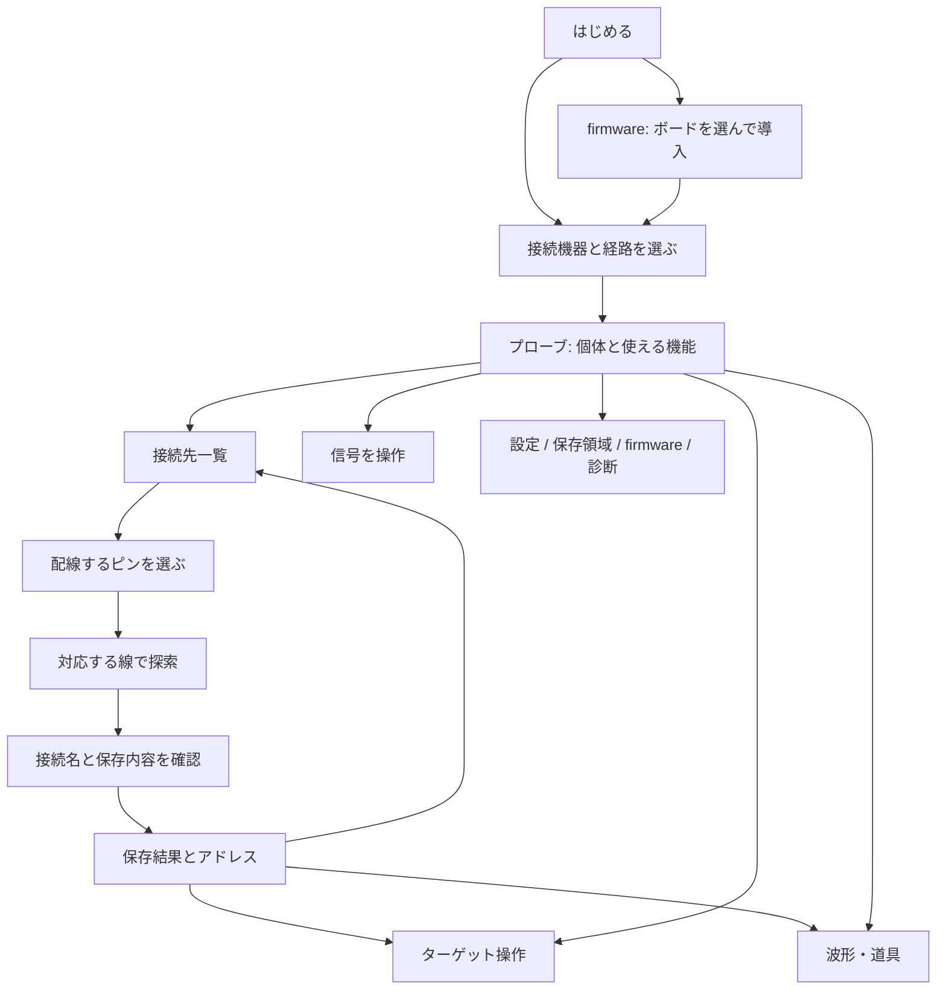

# OEP Probe Tool の要件と画面設計

## 1. このページで終えられる仕事

OEP Probe Tool は、OEP プローブを導入し、接続したプローブとその先の機器を、ブラウザから設定・操作する作業場所である。
初めて使う人はボードへの firmware 導入から始められ、既にプローブを持つ人は接続してすぐ作業を選べる。
機能を使うために仕様の fn/op 番号を覚える必要はない。

利用者が終えられる仕事を次のように定める。

| 仕事 | 完了の条件 |
| --- | --- |
| プローブを準備する | 対応ボードと導入方法を選び、firmware を書き、OEP プローブとして接続できる |
| 状態を知る | 個体、firmware、接続経路、使用できる機能、変更操作の可否が分かる |
| 接続先を登録する | 配線したピンだけでターゲットを探し、接続名・ピン名と任意のメモを保存し、アドレスを得る |
| 信号を操作する | 対応する GPIO、UART、I2C/SPI の主・相手、PWM、カウンタ、DAC を設定し、実行結果を確認できる |
| ターゲットを調べる | RVSWD/SWIO/SWD で接続し、対応するデバッグ操作、メモリ・レジスタの操作、コンソールが使える |
| 波形を取得する | プローブの取得機能を確認し、WireSkein の取得コマンドとビューアへ進める |
| 設定を管理する | 宣言された設定を読み書きし、実行中の変更と永続保存を区別し、控え・復元ができる |
| 記録を管理する | メモ領域の一覧・読み書き・削除とファイルの入出力ができる |
| 保守・問題の調査 | firmware の更新、宣言の確認と保存、シリアル速度の検査、操作履歴の確認ができる |

キャプチャの取得・表示・復号・照合は WireSkein を使う。ターゲット固有の flash 書き込みはデバイスに対応する外部ツールに渡す。
このページはプローブ自身の firmware を更新できるが、それをターゲットの flash 書き込みと混同しない。

## 2. 参考実装から採るもの

- `wireskein-web/web/`: 最初の画面に主な操作を置く。入力後は結果を中心にし、操作のすぐ近くで状態を示す。
- `ESP32SerialCtl/docs/`: 接続状態を常時表示し、接続した機器の操作を用途ごとに切り替える。フォームと結果を同じ場所に置く。
- OEP 固有の要件: ボード名の静的な対応表より、接続したプローブが宣言する機能・revision・操作・ピン候補を優先する。

紹介記事をスクロールし続けないと作業へ進めない構成は採らない。OEP の概要、ボードの比較、ドキュメントは独立した案内から読める。

## 3. 画面と URL

共通のヘッダーに接続個体・状態、変更権の取得/解放、切断、言語を置く。左のナビゲーションを用途の切替に使う。
狭い画面ではナビゲーションを横に並べる。画面移動で接続・入力・結果を失わない。戻る/進むと URL の直接指定を使える。

| 画面 | URL | 内容・主な次の操作 |
| --- | --- | --- |
| はじめる | `#home` | 「プローブに接続」「ボードをプローブにする」。短い目的説明、ブラウザの対応状況 |
| プローブ | `#probe` | 個体と能力、登録された接続先、目的別の作業への入口 |
| 接続先 | `#targets` | 保存された接続名・配線・メモ・アドレス。登録された配線は現在の接続検出結果とは区別する |
| 接続先を追加 | `#target/new` | 配線→探索→命名と保存→完了の順に進む。前へ戻って修正できる |
| 信号を操作 | `#signals/<機能>` | 宣言された機能/インスタンスを選び、ピンを割り当て、設定・送受信・停止・解放する |
| ターゲット操作 | `#debug` | 線とピンを選んで接続。接続中のターゲットの制御、メモリ、レジスタ、コンソール |
| 波形・道具 | `#tools` | WireSkein、CH32 用ツール、Python。接続中の個体を入れたコマンド、コピー |
| 設定 | `#settings` | 現在値、宣言に沿った編集、未保存の表示、永続保存、ファイルの控えと復元の差分確認 |
| 保存領域 | `#storage` | メモオブジェクトの一覧、テキスト編集、バイナリのファイル入出力、削除 |
| firmware | `#firmware` | 初回導入と接続中プローブの更新。ボード/画像/版/手順、進行、再接続 |
| 診断 | `#diagnostics` | 全宣言のテキスト/JSON保存、シリアル速度検査、操作履歴 |
| 案内 | `#help` | OEP の概要、ボード比較、配線/ブラウザ/外部ツールの説明と資料 |

旧 URL `#target`、`#try`、`#details`、`#start`、`#boards` などは対応する新しい画面へ転送する。

## 4. 主要な画面遷移

- 接続が必要な画面を未接続で開いた場合、その画面の目的と接続フォームを表示する。接続後は元の画面へ戻る。
- 接続直後は読み取り専用。変更操作のある画面には「変更操作を有効にする」と、その間のピン占有の説明を置く。
- 他のホストが使用中なら所有者とエラーを表示し、強制取得はしない。
- 変更権を解放すると一時的なピン割当・出力・ターゲット接続が終了する。保存済みの設定/接続名/記録と区別する。
- 切断や再起動/セッション喪失後は、一時オブジェクトと画面上の有効状態を破棄する。状態を変えた要求を自動で繰り返さない。

## 5. 各作業の要求

### 接続先の登録

1. 宣言されたデバッグ線を選び、使用するピンを選ぶ。GND とターゲットの電源/電圧の確認を案内する。
2. 選択したピンの組だけを探索する。選択を変えたら以前の検出結果を破棄する。検出ゼロも結果として明示する。
3. 結果を選び、接続名・型番・メモを入力する。既存の名前を意図せず上書きしない。
4. ピン名の変更と永続保存を行う。メモは対応するプローブにのみ保存する。途中失敗を完全成功と表示しない。
5. 保存できた範囲とアドレスを表示し、一覧・ターゲット操作・外部ツールへ進める。

### 信号を操作

機能ごとに「ピン割当」「設定」「操作と結果」「停止/解放」を持つ。別の画面に移動しても出力を勝手に止めず、
共通の変更権表示と割当表示から終了できる。非対応機能は理由を表示し、実行しない。

- GPIO: ピンとモードの設定、レベルの読み取り、割当解放。
- UART: インスタンス、RX/TX、baud、設定、テキスト/hex送信、受信、表示クリア、割当解放。
- I2C 主: SDA/SCL、clock、stretch timeout、アドレス、write/read/write-read、結果と NACK の区別。
- SPI 主: SCK/MOSI/MISO/CS、mode/order/clock、hex送受信と実際に採用された値。
- I2C 相手: アドレス設定、応答データの投入、受信フレームと待ち数/エラーの確認。
- SPI 相手: mode/order、応答データを置いて受信待ち、受信bit数とデータ、状態確認。
- PWM: ピン、周波数、duty、出力開始、停止、採用された値と状態。
- カウンタ: ピン、計測窓とエッジ、実際の窓時間と計数。
- DAC: ピン、宣言されたbit数/電圧範囲、raw値の設定、状態、解放。

### ターゲット操作

RVSWD/SWIO/SWD、宣言されたピンと速度を選び、接続/切離しを明示する。
RISC-V は停止・再開・step・reset、メモリ読み書き、レジスタ読み取り。ARM は ADI/MEM-AP と Cortex-M の停止・再開・reset、
メモリ読み書き、レジスタ読み書き。対応する操作だけを有効にする。console は利用可能な方式を選んで開き、読み書きする。
書き込み先/値は操作前に入力欄で明示する。ページを離れても接続中であることを表示する。

### 設定と保存領域

- 設定名・型・選択肢・対象はプローブの宣言を使う。秘密の値を表示/履歴へ出さない。
- 「適用」は現在の設定、「プローブに保存」は再起動後も残す操作として区別する。
- ファイル復元は set/unset・未解決項目・別個体のファイル・値のない秘密項目を適用前に表示する。
- 全消去/オブジェクト削除は対象と影響を表示して確認する。メモのバイナリはテキスト化せず保存できる。

### firmware

初回導入はボードを選ぶ。接続中の更新はプローブが名乗るモデルから画像を選ぶ。P4 と P4X を混同しない。
manifest がない/取得に失敗した場合は書き込まず、入手先と手動導入の案内を出す。画像の sha256 を検証してから書く。
書き込み中は二重実行と画面からの再実行を防ぐ。完了後は再接続を明示し、以前のセッションを再利用しない。

## 6. 共通の動作と表示

- 英語/日本語。初期値はブラウザの言語、手動選択を保存する。機器の名前、ユーザー入力、ログの技術情報は翻訳しない。
- 接続待ち、読込中、実行中、成功、部分失敗、失敗、未対応、空の結果を区別する。結果は実行したフォームの近くに残す。
- 二重実行を防ぎ、処理の開始/終了を操作履歴に残す。通信エラー後に成功状態を残さない。
- 画面の切替はフォーカスを見出しへ移す。フォームにラベルを付け、キーボード操作、狭い画面、OS の明暗設定に対応する。
- スクリプト/外部の文字列を HTML として挿入しない。機器の情報や入力ファイルをサーバーへ送信しない。
- HTTPS/localhost と API の有無を確認し、使えない接続方法には理由を付ける。USB/Serial/HID の違いを説明する。

## 7. 実装と確認

画面は `web/`、通信は既存の `src/`、ボード案内は `web/boards.js`。プロトコルを画面に再実装せず、依存を増やさない。
受入れ確認は未接続の全画面/直接URL/戻る進む/言語/画面幅、仮想プローブでの接続・機能選択・設定・送受信・失敗・セッション解放、
サイトビルドとライブラリの既存検査を含む。実機の USB 権限、電気的な入出力、firmware 書き込みは実機試験として結果を分けて報告する。
